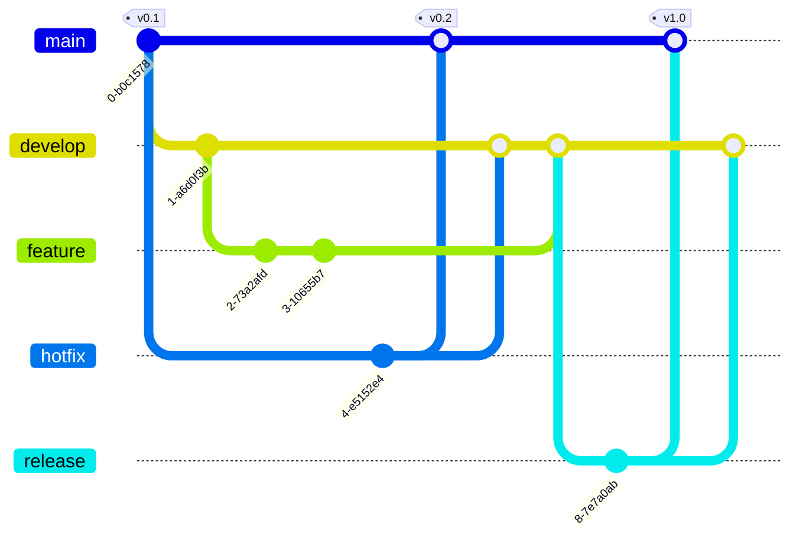

# GitFlow

## Definition

> [!definition] GitFlow
> **GitFlow** is a git branching model with two long-living branches, **main** (the official release history) and **develop** (the integration branch for features), plus short-lived **feature**, **release** and **hotfix** branches. Published by Vincent Driessen; in the EPRM course, main points to production and develop to acceptance.

## Intuition

> [!intuition] Branches that mirror environments
> If the state of main is always the state of production and the state of develop is always the state of acceptance, then "what is live?" is answered by looking at a branch, and making something live means merging into it. Protecting those branches protects the environments.

## The branches

- **Feature** branches start from develop and merge back into develop; they never touch main. They carry new features, refactoring and bug fixes.
- **Release** branches start from develop, take only fixes and release tasks, then merge into main (tagged with a version) and back into develop.
- **Hotfix** branches are the only ones that start from main: they patch production quickly and merge into both main and develop.
- **Merging into main and develop is protected** and triggers continuous deployment (CD) to the matching environment.

## Pull requests

A **pull request (PR)** asks the team to merge a branch and opens its changes for review. Reviewers approve or reject; an unapproved PR cannot be merged. Author and reviewers share responsibility, seniority plays no role (anyone can review), and reviews raise quality and spread knowledge. The risk is ego: aggressive reviewers, authors who take comments personally. Good PRs are small and focused on one problem, split into logical commits, come with tests and have a concise, complete description written by the author.

## Key Properties / Variants

- **Legacy status.** Atlassian calls GitFlow a legacy workflow that has lost popularity to **trunk-based development** (small changes merged into one main branch often), which suits continuous delivery better. GitFlow's many long-lived branches and larger merges make CI/CD harder.

## Connections

- Maps onto: [[Development, Acceptance and Production Environments]]
- Part of: [[MLOps]] (code, build, release)

## Appears In

- [[EPRM-L03 - Containerization and Software Engineering Processes]]
