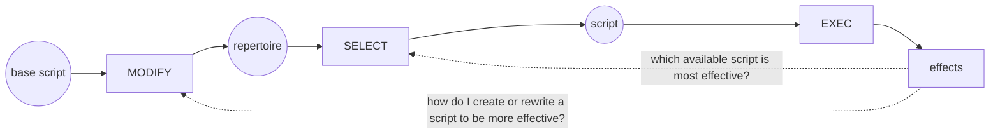
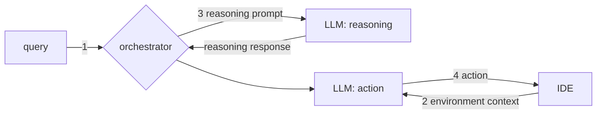
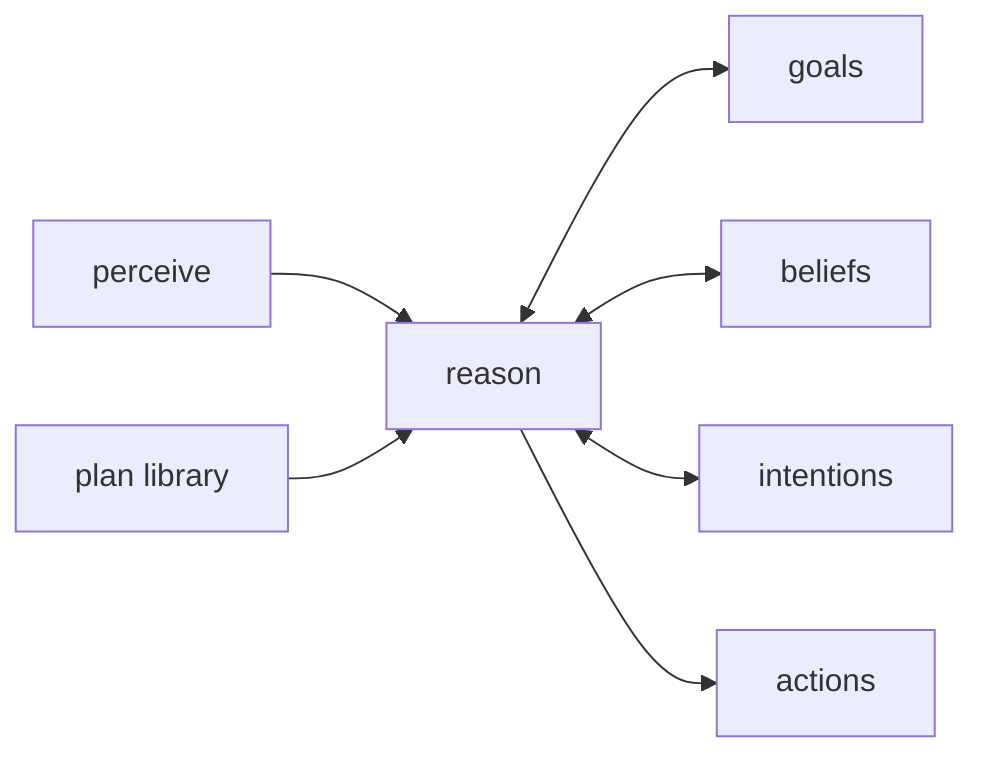
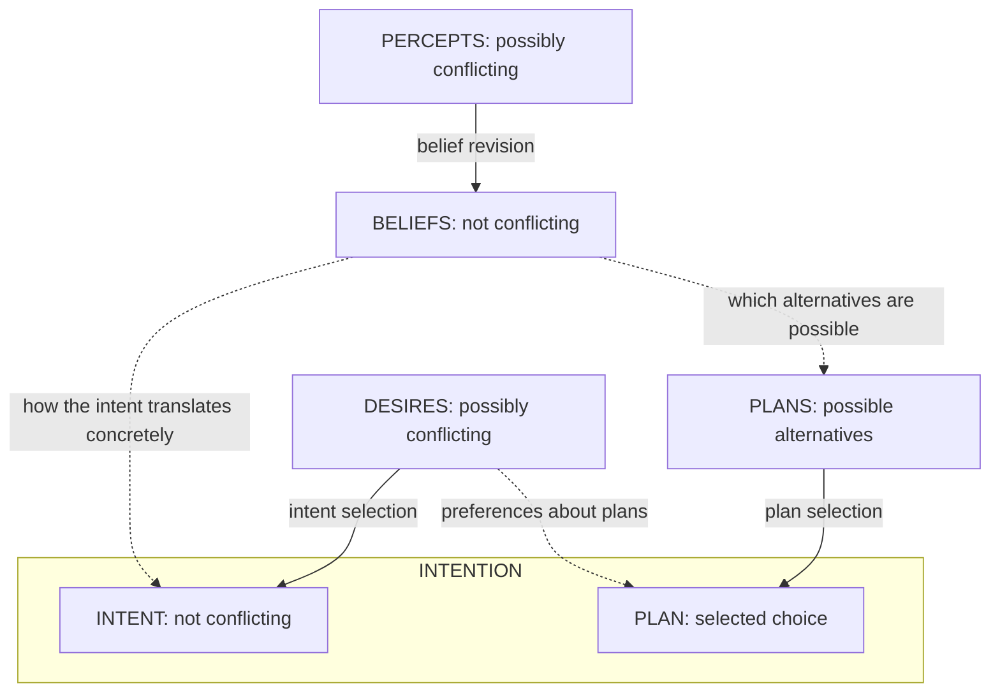

# AGAI-L06b: What Would Make a Chatbot an Agent

> [!abstract] In short
> A guest lecture by Giovanni Sileno (UvA) on one question: is a tool-using chatbot, marketed as "agentic AI", an agent, and if not, what would make it one? Objects occupy space and events time; actors produce changes; agents are actors we ascribe intentions to (Dennett's intentional stance). Behaviour splits into executing a script, selecting it from a repertoire, and modifying it over time.
>
> Beliefs and desires are not enough: an agent also needs intentions, a settled commitment to a goal and a plan, reached by weighing choices and their side effects (Bratman, the BDI model). Sileno's CAES model (commitments, abilities, expectations, susceptibilities) gives this a cleaner structure and maps onto the harness of a coding agent. Today's "AI agent" is an LLM plus a harness; "agentic AI" orchestrates several agents.
>
> The midterm lists Lecture 6 only under Deep MARL, which is part 1; whether this part is examined there is not stated. It feeds the final exam, whose format is not announced.

## The question: is a tool-using chatbot an agent?

"Agent" means rather different things across disciplines, even inside computing; at the very least it works as a **metaphor**. It comes from Latin *agere*: acting towards, driving behaviour. The same word covers the rational agent of philosophy, political agency (people acting to change their society), the artificial "rational" agent of AI (the perceive-act loop of [[Intelligent Agent|Russell and Norvig]]), and, for humans, acting **on behalf of** someone else (a secret agent).

Sileno's guiding question:

> Is a tool-using chatbot (commonly marketed as "Agentic AI") an agent? If not, what would make it one?

He builds the notion of agent from the ground up to answer it.

## Objects, events and actions

He starts from a common-sense ontology (an inventory of the basic kinds of things).

- **Objects** are relatively persistent entities that occupy a position in space. Agents are objects too: an actor on a stage is also a body in a place.
- **Events** are to time what objects are to space: **objects : space = events : time** (Zacks and Tversky, 2001). Events occupy time and *involve* objects, because they produce **changes** on objects, though a sequence of events can bring back the initial conditions (open a door, then close it).
- **Actions** are events driven by agents; their completed forms are **acts**. Communication acts are **speech acts** (acts done by saying something, such as asking or promising).

## Dennett's stances

Daniel Dennett (*The Intentional Stance*, 1987) describes three ways of interpreting an entity, each built on the one below (see [[Intentional Stance]]):

- **Physical stance:** interpret it using physical laws. Where a billiard ball goes follows from where and how hard the cue strikes it.
- **Design stance:** interpret it by what it is supposed to do, what it has been designed to do. You read the time off a clock without knowing its mechanism. Sometimes the clock breaks; then design-stance predictions fail and only the physical stance explains what it does.
- **Intentional stance:** interpret the entity as an agent.

> [!definition] Intentional stance (Dennett)
> Interpreting entities as **agents**, ascribing them **beliefs, desires, intentions** and *enough rationality* to do what they *ought to do* given those beliefs and desires.

We take this stance constantly: towards a child, players at a poker table (what does she think I'm holding?), a cat whose posture says "I'm scared", and whole countries ("the EU fears..."). It is a choice of description, the lesson of Russell and Norvig's calculator caveat in [[AGAI-L01 - Agents, Multiagent Systems and Agentic AI|Lecture 1]]: "agent" is a tool for analysing systems. (Outside the lecture: Dennett justifies the stance by its predictive success. A chess program's next move is far easier to predict by assuming it wants to win than from its code.)

## Objects, actors and agents

The stances give Sileno a three-way split:

- **Objects** are passive entities: they undergo changes due to others' actions. An apple.
- **Actors** are active entities: they produce changes. A volcano; the services of a software system, each acting on requests.
- **Agents** are actors **ascribed with intentions**. An erupting volcano is an actor; a fire spirit that erupts because it is angry is an agent.

The key word is *ascribed*: agency is attributed by an observer, as in the intentional stance.

### What intentions are in an artificial agent

Allen Newell ("The Knowledge Level", 1982) gives a minimal structure:

> "An agent [..] has an extremely simple structure. [..] First, the agent has some **physical body** with which it can act in the environment (and be acted upon). [..] Second, the agent has a **body of knowledge**. This body is like a **memory**. Whatever the agent knows at some time, it continues to know. [..] Third, and finally, the agent has a **set of goals**. A goal is a body of knowledge of a state of affairs in the environment. Goals are structurally distinguished from the main body of knowledge. This permits them to enter into the behavior of the agent in a distinct way, namely, that which the organism strives to realize."

Sileno reads this as a **body** that senses and acts (providing percepts to the mind, realising actions in the environment) plus a **mind** that controls the body using knowledge and goals. **Rationality** (compare [[Rational Agent]]) is expressed by the interaction of knowledge, goals and situated action, and it hints at verbalisation: it refers to **explicit reasons** weighed when taking a decision. **Intelligence**, "executing the correct action in a situation", generalises this and needs no verbalisation. So his minimal starting point for an artificial *intelligent* agent is:

- a **body**, sensing and acting in an environment;
- a **mind** controlling the body, depending on some form of **memory** and some form of **purpose**, possibly implicit.

Functionally, memory maps at least to **beliefs** and purpose to **desires**. Sileno then asks in what sense an LLM-centred chatbot is an intelligent agent, and leaves it open. On the minimal definition it arguably qualifies, with tools as body, context as memory and the prompt as implicit purpose (worked here, not given in the lecture). Whether beliefs and desires are enough comes up under intentions below.

## Which things are agents?

Sileno puts a series of cases without verdicts: an ant, a bee in its hive, a clock, a pen, a heart, a forest, a community, a program, a robotic arm, a thermostat. He then gives Wooldridge and Jennings' criteria:

> [!definition] Weak agency (Wooldridge and Jennings, 1995)
> - **Reactivity:** perceives and responds to changes in its environment.
> - **Proactivity:** takes initiative driven by goals or intentions rather than simple input-output mapping.
> - **Autonomy:** operates without continuous external intervention.
> - **Social ability:** interacts with other agents to coordinate, compete, or negotiate.

(Outside the lecture: Wooldridge and Jennings call this notion *weak* because it is the relatively uncontentious one; their *strong* notion also describes the agent in mental terms such as beliefs, desires and intentions, which is where BDI comes in.)

One way to apply the criteria (worked here, not given in the lecture):

| Entity | Reactive | Proactive | Autonomous | Social |
|---|---|---|---|---|
| Pen | no | no | no | no |
| Clock | no | no | yes | no |
| Heart | yes | no | yes | no |
| Thermostat | yes | doubtful | yes | no |
| Robotic arm | if it senses | if goal-driven | partly | no |
| Ant, bee | yes | yes | yes | yes |
| Community | yes | arguably | yes | yes |
| Chatbot with tools | yes | via its harness | within a task | among agents only |

The thermostat is the borderline case. It reacts and runs alone, but its "goal" (the set temperature) is a fixed input-output mapping, which is what proactivity excludes; saying "it wants the room at 20 °C" adds as little as it does for the calculator. The chatbot's initiative comes from a goal stated in the prompt and the loop around the model, so its proactivity belongs to the harness.

## Agent-based modelling

**Agent-based modelling (ABM)** studies a system by simulating its interacting agents (see [[Agent-Based Modelling]]). There are two main ways to specify the agents' behaviour.

**Cellular automata**, generally as **if-then rules**: each cell on a grid updates its state from its neighbours'. In Rule 22, a cell becomes 1 if there is exactly one 1 in its three-cell neighbourhood (left, centre, right). Simple local rules like this produce complex global patterns; Conway's Game of Life and Schelling's segregation model are other examples. **Agent-oriented programming**, for example of BDI agents, is a more expressive approach in the same arena: rules over beliefs, desires and intentions.

**Equations**, possibly differential (ODE or PDE: ordinary or partial differential equations), traditionally more associated with economics, such as a model of a price over time.

For **spreading dynamics** (how a disease, rumour or behaviour spreads), the **topology** enabling interactions, who can meet whom, becomes particularly relevant, which leads to **network science**.

### Approaches to ABM in game theory

Game theory traditionally has two approaches too (see [[AGAI-L02 - Game Theory and Population Dynamics|Lecture 2]]):

| | Classic game theory | Evolutionary game theory |
|---|---|---|
| Rationality | perfectly rational | bounded, possibly non-rational |
| Cognition | forward-looking: anticipate, decide, then act | replicative (mimesis?), possibly adaptive |
| Agents | different, very few | similar, very many |
| Typical tool | payoff matrix ([[Prisoner's Dilemma]]) | [[Replicator Dynamics]] |

"Mimesis" means imitation (the question mark is Sileno's): strategies spread because agents copy what works, without anyone reasoning ahead.

## A theatrical view of agency

Sileno separates the aspects of behaviour with a theatre metaphor:

1. At a given time, the agent's behaviour follows a definite **script**: **EXEC** (the actor performs).
2. So at an earlier point this script was **selected**: **SELECT** (the director picks the play). SELECT presupposes a **repertoire** of scripts.
3. So at an earlier point still, the script was either **created** or **adapted** from a previous one: **MODIFY** (the playwright writes). MODIFY may be due to external events, for example transcription errors acting as **mutation**.

SELECT and MODIFY behaviour are themselves scripts that are executed, and that at some point were selected and created or modified, and so on, **recursively**, down to some **hard-coded ground**.

### A layered view of action, including learning



Learning is feedback from effects, as in the learning agent of [[Agent Program|Russell and Norvig]]. At the SELECT level it asks which available script is most effective; at the MODIFY level, how to create or rewrite a script to be more effective.

Sileno's exercise asks three questions of an agent. **EXEC:** what script is being executed right now? **SELECT:** how is a script chosen from a repertoire? **MODIFY:** how is a script rewritten or updated over time? He poses them for three cases without answers. Worked answers (not given in the lecture):

> [!example] A Q-learning agent on a grid world, acting epsilon-greedily
> **EXEC:** the move made in the current cell. **SELECT:** [[Epsilon-Greedy Policy|epsilon-greedy]]: with probability $1-\varepsilon$ the move with the highest Q-value, otherwise a random one of the four moves. **MODIFY:** the [[Q-Learning]] update, which rewrote Q-values from rewards while the policy was learned; once the policy is only applied, MODIFY is off. With single moves as scripts, Q-learning is learning at the SELECT level; with the whole policy as the script, each update is a MODIFY. The update and epsilon-greedy rules are the hard-coded ground.

> [!example] Tit-for-tat
> **EXEC:** this round's move, cooperate or defect. **SELECT:** copy the opponent's previous move (cooperate on the first). **MODIFY:** none: [[Repeated Game|tit-for-tat]] is a fixed rule, its own hard-coded ground. Change happens only at the population level, where replicator dynamics and mutation alter the mix of strategies.

> [!example] Your train stops for a long time at the wrong station
> **EXEC:** the commuting script (sit, wait for your stop), whose assumptions the stop breaks. **SELECT:** pick a disruption script: wait, switch train, take a bike, message that you'll be late. **MODIFY:** if none fits, improvise; afterwards adapt the commute (leave earlier, check for disruptions).

## What today's "AI agents" are

The common definition: an **AI agent** is "an autonomous system where a LLM decides what to do next, which tools to use, and when the task is complete". Sileno calls this the recent common sense of the term, "but strictly speaking wrong". Such an agent takes user input, works with databases, local files, APIs and sensors, and produces output actions.

The most fundamental architectural component handles the interaction with the LLM: a query comes in, the component prompts the LLM, and the generated response goes back out. Intelligent behaviour, though, generally comes from an **orchestration** of several components, as in a simple coding agent harness:



In formula form:

$$\text{AI agent} \approx \underbrace{\text{LLM}}_{\text{the "brain"}} + \underbrace{\text{planning} + \text{memory} + \text{tool use} + \text{guardrails} + \dots}_{\text{the harness, or scaffolding}}$$

This is the [[LLM Agent]] of Lecture 1, with everything around the model named the **harness**. It motivates the lecture: a rich research field on agents and multi-agent systems predates LLMs (for example programming BDI agents in AgentSpeak with Jason, by Bordini, Hübner and Wooldridge); the current "agentic AI" discourse overlooks it or is only slightly informed by it; and its **architectural insights** can show how to use the new technology best.

## Intentions: what beliefs and desires miss

### Bratman's chocolate

Is a belief-desire architecture sufficient? Michael Bratman (*Intention, Plans, and Practical Reason*, 1987):

> "Suppose I have a **fleeting craving** for a chocolate bar, one which induces a fleetingly **predominant desire** to eat one for dessert. And suppose that just as fleetingly I notice this desire and judge (in a spirit of resignation, perhaps) that it will lead me so to act. But then I **stop and reflect**, **recall** my dieting plans, and **resolve** to skip dessert. On the present desire-belief account I had a **fleeting intention** to have a chocolate dessert. But I am inclined to say **I had no such intention**, for I was never appropriately settled in favor of such a dessert."

On a desire-belief account, an intention is a predominant desire plus a belief that it will lead to action, so the craving counts as one. Bratman denies it: he was never *settled* on the dessert. Intention is a distinct state, being settled on (committed to) a course of action, and his earlier dieting plans are what overrode the desire.

### The BDI model

In symbolic AI, multi-agent systems and philosophy of action, beliefs, desires and intentions map onto three distinct mental states and practical levels of reasoning (see [[BDI Model]]):

> [!definition] Beliefs, desires, intentions (BDI)
> - **Informational level:** what the agent **believes** to be the case in the world.
> - **Volitional level:** what the agent **desires** to be the case in the world.
> - **Deliberative level:** what the agent is **committed to** in the world.

> [!example] Toothache
> **Belief:** "I have pain with my tooth. (I believe) my tooth has a cavity." **Desire:** "I don't want to have pain. I want my tooth to be cured." **Intention:** "I am going to my dentist."

Once I commit to a conduct, there are more consequences than the desired outcome: the dentist also brings the drill and the bill. **Intention includes side effects besides the intent or goal.** Hence Sileno's architectural claim: if you architecturally miss the function of intention deliberation, you miss performing (offline or online) an **evaluation and weighing of possible choices**. He asks when this is critical and leaves it open. One answer (worked here, not given in the lecture): when side effects are costly or irreversible, as for an agent that can delete files or spend money.

### Intent selection and plan selection

Following Georgeff and Rao (1991), deliberation involves two selections:

- **Intent selection.** At a given moment I may form several, possibly conflicting desires, and must give a priority on which goal to advance. A donkey both hungry and thirsty, standing between hay and water, has to pick one first.
- **Plan selection.** Given any intent, I may have several plans to advance it, and must give a priority on which plan to commit to. To get to the university: bike or tram?

Sileno flags a possible **categorial leap** between them: a goal may be about a **situation** (a state of the world), while a plan is always a **conduct**, a **composite action**. There are ways to correct this, such as reading the goal as *achieving* a situation.

The same structure shows up in practitioner guides, such as AWS's "perceive-reason-act loop" for agentic AI, where a reasoning core works with goals, a plan library, beliefs and intentions:



### Why it gets messy

Laid out in full, the BDI pieces form a tangle:



Intent selection resolves conflicting desires into one non-conflicting **intent**; plan selection picks one of the alternative plans; **intention = intent + selected plan**. Desires set preferences about both the intent and the plans. Percepts can conflict too (one person says it's sunny, another that it's raining) and must be resolved into consistent beliefs, the subject of the **belief revision** and **data fusion** literature. Beliefs about the current state of the world then determine which alternatives are possible and how the intent translates concretely.

In Sileno's words it "rapidly becomes very messy", so he proposes a different template.

## CAES: commitments, abilities, expectations, susceptibilities

Sileno's **CAES model** (Boer and Sileno, "Anchoring Distributed Agency") regroups the BDI pieces into columns: **commitments** (structural, contingent) take over desires and intent, **abilities** (skills, competences) take over plans and plan selection, and **expectations** (structural, contingent) take over percepts and beliefs. A fourth component, **susceptibilities**, has no BDI counterpart. See [[CAES Model]].

> [!definition] CAES model (Boer and Sileno)
> - **Commitments:** what the agent *wants to achieve* in the world (intent selection).
> - **Abilities:** what the agent *can achieve* in the world, and *how* (plan selection).
> - **Expectations:** what the agent *knows about* the world (belief revision).
> - **Susceptibilities:** what the agent *is looking at* in the world, and *how* it responds to it (attention allocation).

```
      C                    E
      | intent             | belief
      | selection          | revision
 A ---*                    *--- S
 plan |                    ^  attention
 selection                 |  allocation
------v-------WORLD--------|------
    acts               perceives
```

Commitments (what) and abilities (how) meet in the action going out to the world. What comes in passes through susceptibilities (what the agent attends and reacts to) and is integrated into expectations. The lecture does not define "structural" and "contingent"; a plausible reading (not given in the lecture) is standing commitments or expectations against ones that arise from the situation.

### Applying CAES to a coding agent

Sileno maps the components onto the simple coding agent harness above.

**Commitments:** the task input ("fix the bug"), constraint input ("preserve the API"), guardrail checks ("don't edit unrelated files"), and completion criteria ("the bug is fixed and relevant tests pass").

**Abilities:** a SKILL.md file exposing how to use the tools, the tools themselves, and the system running them.

**Expectations:** the working state or context, memory, the code repository, retrieved evidence, or better, models of these.

**Susceptibilities:** watchers and triggers, tool-result handlers, interrupts and escalation routing, including their functional connection to the other components.

> [!example] Running example: a test fails
> 1. The failure is received and routed (**S**).
> 2. The context is updated (**E**).
> 3. What is the problem? Repair the bug (**C**).
> 4. Choose an available debugging skill (**A**).
> 5. And so on: a **problem-solving cycle**.

Some of this mapping can be done already. However, it refers either to **low-level constructs**, for which there is not yet a sufficiently interoperable declarative language, or to **higher-level directives**, where we don't know how the LLM is going to interpret them. (An illustration not from the lecture: a guardrail coded as a file-permission check is precise but system-specific; written in the prompt as "don't edit unrelated files", it is left to the model's reading.)

## Agentic AI

> [!definition] Agentic AI (common definition)
> An autonomous system that performs complex, multi-step tasks by **orchestrating** multiple computational tools, including language models (LLMs), to make decisions and execute a series of actions to reach a desired outcome.

Sileno: "again bad name". An AI agent is one agent with its tools; agentic AI coordinates several agents around an orchestrator, much like a [[Multi-Agent System|multi-agent system]]. There are two opposite approaches:

- **Agentic workflow:** the workflow governs the agents. A fixed pipeline decides who does what and when.
- **Autonomous agent:** the workflow is governed by the agents, for example agents autonomously improving their own harness.

He leaves two questions open: is agentic AI an agent, and is it an AI agent? His closing claim: "If we are seeking to create 'rational' agents, we cannot but expect to proceed towards CAES-like frameworks."

### Back to the question

Sileno gives no verdict. Putting his pieces together (worked here, not given in the lecture): a tool-using chatbot meets the minimal bar for an intelligent agent (a body of sorts, memory, an implicit purpose), and we can take the intentional stance towards it. As an intentional, rational agent it lacks an architectural place for deliberation: explicit commitments, intent and plan selection that weigh choices and side effects, and susceptibilities that decide what it attends to. A harness built along CAES lines would supply them, which is where his closing claim points.

## What to be able to write

- Dennett's three stances with examples; objects, actors and agents; why agency is ascribed.
- Weak agency applied to a thermostat and a chatbot.
- EXEC, SELECT, MODIFY and learning, applied to a Q-learning agent.
- Why Bratman's chocolate shows intentions are needed; the BDI levels; side effects; intent and plan selection.
- CAES applied to a coding agent and a failing test, and the limits of the mapping.
- AI agent against agentic AI, workflow against autonomous agent, and whether a chatbot is an agent.
- The two approaches to ABM; classic against evolutionary game theory.

Full model answers are in the exam questions below.

## Exam questions

> [!exam]- Describe Dennett's three stances, with an example of each. How do they relate to Sileno's distinction between objects, actors and agents?
> **Key points:** physical stance: physical laws (billiard ball); design stance: what it was designed to do, fails when it breaks (clock); intentional stance: ascribe beliefs, desires, intentions and enough rationality to do what it ought to do (poker player, cat, countries); objects passive, actors produce changes, agents are actors ascribed intentions; agency is ascribed by an observer.
>
> Dennett distinguishes three ways of interpreting an entity. In the **physical stance** we predict its behaviour from physical laws, as with a billiard ball struck by a cue. In the **design stance** we predict it from what it is supposed to do, what it was designed to do: we read the time from a clock without knowing its mechanism. Design-stance predictions hold only while the thing works; when the clock breaks, only the physical stance explains it. In the **intentional stance** we interpret the entity as an agent, ascribing it beliefs, desires and intentions and enough rationality to do what it ought to do given them, as we do with poker players, a cat's body language, or countries in geopolitics.
>
> Sileno's common-sense ontology mirrors this. **Objects** are passive: they undergo changes due to others' actions (an apple). **Actors** are active: they produce changes (a volcano, the services of a software system). **Agents** are actors ascribed with intentions. The word "ascribed" matters: whether something is an agent depends on whether an observer takes the intentional stance towards it, which echoes Russell and Norvig's point that "agent" is a tool for analysis.

> [!exam]- State Wooldridge and Jennings' four characteristics of weak agency. Use them to discuss whether a thermostat and a tool-using LLM chatbot are agents.
> **Key points:** reactivity: perceives and responds to changes; proactivity: initiative driven by goals or intentions beyond input-output mapping; autonomy: no continuous external intervention; social ability: coordinate, compete, negotiate with other agents; thermostat reactive and autonomous, proactivity doubtful, not social; chatbot reactive, partly autonomous, proactivity depends on its harness, social only in multi-agent setups.
>
> **Reactivity:** the entity perceives and responds to changes in its environment. **Proactivity:** it takes initiative driven by goals or intentions rather than a simple input-output mapping. **Autonomy:** it operates without continuous external intervention. **Social ability:** it interacts with other agents to coordinate, compete or negotiate.
>
> Sileno poses the cases without verdicts; what follows is one defensible application. A thermostat is reactive (it switches the heating when the temperature changes) and autonomous (it runs alone), but its "goal", the set temperature, is a fixed input-output mapping, so proactivity is doubtful, and it has no social ability. It is a borderline case where the intentional stance is possible but adds little, as for Russell and Norvig's calculator. A tool-using chatbot is reactive to prompts and tool results and autonomous within a task. Its initiative comes from a goal stated in the prompt and the loop around the model, so its proactivity belongs to the harness. It is social only when placed among other agents. So it meets weak agency partly, and the open question is what would give it genuine goal-driven initiative, which is where BDI and CAES come in.

> [!exam]- Explain Sileno's "theatrical" view of agency (EXEC, SELECT, MODIFY) and how learning fits in. Apply it to an agent whose policy was learned with Q-learning and is applied with epsilon-greedy selection.
> **Key points:** EXEC: behaviour follows a definite script; SELECT: the script was chosen from a repertoire; MODIFY: the script was created or adapted, possibly by external events such as mutation; SELECT and MODIFY are scripts too, recursively, down to hard-coded ground; learning as feedback from effects to SELECT (which script is most effective) and MODIFY (how to make a script more effective); Q-learning: EXEC the move, SELECT epsilon-greedy over Q-values, MODIFY the Q update; update rules are the ground.
>
> At any given time an agent's behaviour follows a definite script, as an actor follows a play (EXEC). That script must have been chosen at an earlier point from a repertoire of scripts (SELECT), and before that it must have been created or adapted from a previous script (MODIFY), possibly by external events, as transcription errors act as mutations. SELECT and MODIFY are themselves scripts that are executed and were once selected and modified, recursively, down to some hard-coded ground. Learning enters as feedback from the effects of execution: learning at the SELECT level asks which of the available scripts is most effective; learning at the MODIFY level asks how to create or rewrite a script to be more effective.
>
> For the Q-learning agent (Sileno leaves the exercise open; this is one defensible answer), EXEC is the move it makes in its current grid cell. SELECT is epsilon-greedy: with probability $1-\varepsilon$ the move with the highest Q-value, otherwise a random move from the repertoire of four. MODIFY is the Q-learning update, which revised Q-values from rewards while the policy was learned and so changed what SELECT prefers; once the policy is only applied, MODIFY is off. Read with moves as scripts, Q-learning is learning at the SELECT level; read with the policy as the script, each update is a MODIFY. The update rule and the epsilon-greedy rule are the hard-coded ground.

> [!exam]- Why is a belief-desire architecture not sufficient for agency? Use Bratman's chocolate example, describe the three BDI levels, and explain why intention deliberation matters for an artificial agent.
> **Key points:** Bratman: a fleeting predominant desire plus belief would count as an intention, but he was never settled on it; intention is being settled or committed; informational level beliefs, volitional level desires, deliberative level commitments (toothache, cure, dentist); intention includes side effects besides the goal; without intention deliberation an agent never weighs its possible choices; intent selection and plan selection (Georgeff and Rao).
>
> Bratman describes a fleeting craving that makes the desire for chocolate predominant for a moment, together with a judgement that it will lead him to act. He then reflects, recalls his dieting plans and resolves to skip dessert. On a desire-belief account he had a fleeting intention to eat chocolate; Bratman says he had no such intention, because he was never settled in favour of it. Intention is therefore a distinct mental state, a settled commitment, which a belief-desire architecture cannot represent.
>
> The BDI model separates three levels: the informational level (what the agent believes is the case: my tooth has a cavity), the volitional level (what it desires to be the case: my tooth cured) and the deliberative level (what it is committed to: going to the dentist). Committing to a conduct brings more consequences than the desired outcome, so an intention includes side effects besides the goal. Sileno's claim is that if an architecture misses intention deliberation, it misses performing, offline or online, an evaluation and weighing of possible choices, so side effects go unexamined. Deliberation involves two selections: intent selection, prioritising which of possibly conflicting goals to advance, and plan selection, prioritising which of several plans to commit to.

> [!exam]- Describe Sileno's CAES model and apply it to a simple LLM coding agent, using the example of a failing test. What limits such a mapping today?
> **Key points:** commitments: what the agent wants to achieve (intent selection); abilities: what it can achieve and how (plan selection); expectations: what it knows about the world (belief revision); susceptibilities: what it looks at and how it responds (attention allocation); coding agent: task, constraints, guardrails, completion criteria; SKILL.md, tools, runtime; context, memory, repository, evidence; watchers, handlers, interrupts, escalation; test fails: S, E, C, A cycle; low-level constructs lack an interoperable declarative language, higher-level directives are interpreted unpredictably by the LLM.
>
> CAES (Boer and Sileno) regroups the tangled BDI picture: commitments take over desires and intent, abilities take over plans, expectations take over percepts and beliefs, and susceptibilities are new. **Commitments** are what the agent wants to achieve in the world, decided by intent selection. **Abilities** are what it can achieve and how, used in plan selection. **Expectations** are what it knows about the world, maintained by belief revision. **Susceptibilities** are what it is looking at in the world and how it responds, set by attention allocation. Commitments and abilities meet on the acting side, expectations and susceptibilities on the perceiving side.
>
> In a coding agent harness, commitments are the task ("fix the bug"), constraints ("preserve the API"), guardrail checks ("don't edit unrelated files") and completion criteria ("the bug is fixed and relevant tests pass"). Abilities are the SKILL.md files exposing tool usage, the tools, and the system running them. Expectations are the working context, memory, the code repository and retrieved evidence, or models of them. Susceptibilities are watchers and triggers, tool-result handlers, interrupts and escalation routing. When a test fails, the failure is received and routed (S), the context is updated (E), the agent identifies the problem and commits to repairing the bug (C), and it chooses an available debugging skill (A): a problem-solving cycle.
>
> The mapping is limited because it relies either on low-level constructs, for which no sufficiently interoperable declarative language exists yet, or on higher-level directives in natural language, whose interpretation by the LLM we cannot know in advance.

> [!exam]- Distinguish an "AI agent" from "agentic AI" as commonly defined, and the two opposite approaches to agentic AI. Is a tool-using chatbot an agent?
> **Key points:** AI agent: autonomous system where an LLM decides what to do next, which tools to use, when the task is complete (Sileno: strictly speaking wrong); AI agent ≈ LLM + harness (planning, memory, tool use, guardrails); agentic AI: orchestrates multiple tools including LLMs to make decisions and execute actions towards an outcome; agentic workflow: workflow governs agents; autonomous agent: agents govern workflow (improving the harness); chatbot meets the minimal definition but lacks deliberation (Sileno leaves the verdict open); CAES-like frameworks for rational agents.
>
> In current usage an AI agent is an autonomous system in which an LLM decides what to do next, which tools to use and when the task is complete; Sileno calls this the common sense of the term but strictly speaking wrong. Architecturally it is an LLM, the "brain", plus a harness or scaffolding of planning, memory, tool use, guardrails and more; intelligent behaviour comes from orchestrating these components. Agentic AI is an autonomous system performing complex multi-step tasks by orchestrating multiple computational tools, including LLMs, to make decisions and execute actions towards a desired outcome: several agents around an orchestrator. In an agentic workflow the workflow governs the agents; with autonomous agents the agents govern the workflow, for example by improving their own harness.
>
> Sileno leaves the verdict open; putting his criteria together, a tool-using chatbot has a body of sorts (its tools), memory (its context) and an implicit purpose (the prompt), so it meets his minimal definition of an intelligent agent, and we can take the intentional stance towards it. It lacks what makes an intentional, rational agent: explicit commitments, deliberate intent and plan selection that weigh choices and their side effects, and explicit attention to what matters. Sileno concludes that building rational agents means moving towards CAES-like frameworks.

> [!exam]- Describe the two main approaches to agent-based modelling and the two traditional approaches to ABM in game theory.
> **Key points:** cellular automata with if-then rules (Rule 22, Game of Life, Schelling); agent-oriented programming (BDI) more expressive in the same arena; equations (ODE, PDE), traditionally economics; network science for spreading dynamics; classic game theory: perfectly rational, forward-looking, few different agents; evolutionary: bounded, replicative and adaptive, many similar agents.
>
> In agent-based modelling, agents' behaviour is specified either as cellular automata, generally if-then rules by which each cell updates from its neighbours (Rule 22: a cell becomes 1 if exactly one cell in its three-cell neighbourhood is 1; Conway's Game of Life; Schelling's segregation model), or as equations, possibly differential ones, traditionally more associated with economics. Agent-oriented programming, for example of BDI agents, is a more expressive approach in the same arena as cellular automata. When studying spreading dynamics, the topology of who can interact with whom matters, which brings in network science.
>
> Classic game theory assumes perfectly rational agents with forward-looking cognition, anticipating and deciding before acting, usually few and different from one another, as in the Prisoner's Dilemma. Evolutionary game theory assumes bounded, possibly non-rational agents whose cognition is replicative (imitation) and possibly adaptive, usually many and similar, studied with replicator dynamics.

## Flashcards

> [!card]- What does the Latin root of "agent", *agere*, mean?
> Acting towards, driving behaviour.

> [!card]- What extra meaning does "agent" take on when applied to humans?
> Acting on behalf of someone else.

> [!card]- Complete the analogy from Zacks and Tversky: objects : space = ?
> Events : time.

> [!card]- What is an action, and what is an act, in Sileno's common-sense ontology?
> An action is an event driven by an agent; an act is its completed form.

> [!card]- What are communication acts called?
> Speech acts.

> [!card]- How does Dennett's physical stance interpret an entity?
> Using physical laws.

> [!card]- How does Dennett's design stance interpret an entity?
> By what it is supposed, or designed, to do.

> [!card]- Why does a broken clock show the limit of the design stance?
> Design predictions hold only while it works; once broken, only the physical stance explains it.

> [!card]- Give Dennett's definition of the intentional stance.
> Interpreting entities as agents, ascribing beliefs, desires, intentions and enough rationality to do what they ought to.

> [!card]- How do objects, actors and agents differ in Sileno's ontology?
> Objects undergo changes, actors produce changes, agents are actors ascribed with intentions.

> [!card]- In Sileno's ontology, what turns an erupting volcano from an actor into an agent?
> Ascribing it intentions, as with a fire spirit erupting because it is angry.

> [!card]- What are the three parts of an agent according to Newell's knowledge level?
> A physical body, a body of knowledge (memory), a set of goals.

> [!card]- How does Sileno distinguish rationality from intelligence?
> Rationality weighs explicit, verbalisable reasons; intelligence, doing the correct action in a situation, needs no verbalisation.

> [!card]- What is Sileno's minimal starting point for an artificial intelligent agent?
> A body sensing and acting, and a mind with some memory and some purpose, possibly implicit.

> [!card]- Name Wooldridge and Jennings' four characteristics of weak agency.
> Reactivity, proactivity, autonomy, social ability.

> [!card]- What distinguishes proactivity from reactivity in weak agency?
> Proactivity is initiative driven by goals or intentions; reactivity is responding to environmental changes.

> [!card]- Which weak-agency characteristic means operating without continuous external intervention?
> Autonomy.

> [!card]- What are the two main approaches to specifying agents' behaviour in agent-based modelling?
> Cellular automata (if-then rules) and equations (possibly ODEs or PDEs).

> [!card]- Which agent-based modelling approach is traditionally associated with economics?
> Equations, possibly differential ones.

> [!card]- How does agent-oriented programming (BDI agents) relate to cellular automata in agent-based modelling?
> It is more expressive, but in the same arena of rule-based behaviour.

> [!card]- What is the rule of cellular automaton Rule 22?
> A cell becomes 1 if exactly one cell in its three-cell neighbourhood is 1.

> [!card]- Why does network science matter for agent-based models of spreading dynamics?
> The topology of who can interact with whom shapes how things spread.

> [!card]- How do classic and evolutionary game theory differ in their agents' rationality?
> Classic: perfectly rational. Evolutionary: bounded, possibly non-rational.

> [!card]- How do classic and evolutionary game theory differ in the number and kind of agents?
> Classic: few, different agents. Evolutionary: many, similar agents.

> [!card]- In Sileno's theatrical view of agency, what do EXEC, SELECT and MODIFY stand for?
> Executing a script, selecting it from a repertoire, creating or adapting it.

> [!card]- What does SELECT presuppose in Sileno's theatrical view of agency?
> A repertoire of scripts.

> [!card]- Where does the EXEC-SELECT-MODIFY regress end, given that SELECT and MODIFY are scripts too?
> In some hard-coded ground.

> [!card]- What question does learning at the SELECT level ask?
> Which of the available scripts is most effective?

> [!card]- What question does learning at the MODIFY level ask?
> How do I create or rewrite a script to be more effective?

> [!card]- For a tit-for-tat agent, what is its SELECT rule?
> Play whatever the opponent played in the previous round.

> [!card]- What does Bratman's chocolate example show about the desire-belief account of intention?
> A fleeting predominant desire is no intention: intention requires being settled on the action.

> [!card]- Name the three BDI levels and their mental states.
> Informational: beliefs. Volitional: desires. Deliberative: commitments (intentions).

> [!card]- Why does an intention include more than its goal, in the BDI model?
> Committing to a conduct brings side effects besides the intended outcome.

> [!card]- What does an architecture lose if it lacks intention deliberation, according to Sileno?
> The evaluation and weighing of possible choices.

> [!card]- What is intent selection (Georgeff and Rao)?
> Prioritising which of several, possibly conflicting goals to advance.

> [!card]- What is plan selection (Georgeff and Rao)?
> Prioritising which of several plans for an intent to commit to.

> [!card]- What categorial leap does Sileno flag between goals and plans?
> A goal may be about a situation; a plan is always a conduct, a composite action.

> [!card]- How can the categorial leap between goals and plans be corrected?
> Read the goal as achieving a situation.

> [!card]- In the BDI picture, what does an intention consist of?
> The selected intent plus the selected plan.

> [!card]- What do desires set preferences about, in the full BDI picture?
> Both the intent and the plans.

> [!card]- What must conflicting percepts be resolved into?
> Consistent beliefs.

> [!card]- Which literatures study resolving conflicting percepts into beliefs?
> Belief revision and data fusion.

> [!card]- What do beliefs about the current world determine in BDI deliberation?
> Which plan alternatives are possible and how the intent translates concretely.

> [!card]- What does CAES stand for?
> Commitments, abilities, expectations, susceptibilities.

> [!card]- Which selection or process goes with each CAES component?
> Commitments: intent selection. Abilities: plan selection. Expectations: belief revision. Susceptibilities: attention allocation.

> [!card]- What are susceptibilities in the CAES model?
> What the agent is looking at in the world, and how it responds.

> [!card]- Which CAES component has no counterpart in BDI?
> Susceptibilities.

> [!card]- In a coding agent, which CAES component covers "preserve the API" and "the relevant tests pass"?
> Commitments (constraint input and completion criteria).

> [!card]- In a coding agent, which CAES component covers watchers, interrupts and escalation routing?
> Susceptibilities.

> [!card]- In the CAES failing-test cycle, what is the order of components?
> Susceptibilities, expectations, commitments, abilities, then around again.

> [!card]- Why is mapping CAES onto LLM harnesses hard today?
> Low-level constructs lack an interoperable declarative language; we can't predict how the LLM interprets higher-level directives.

> [!card]- What is an AI agent in the common definition Sileno calls "strictly speaking wrong"?
> An autonomous system where an LLM decides what to do next, which tools to use, and when the task is complete.

> [!card]- What is the harness, or scaffolding, of an AI agent?
> Everything around the LLM: planning, memory, tool use, guardrails.

> [!card]- How is agentic AI commonly defined?
> An autonomous system orchestrating multiple tools, including LLMs, to decide and act towards an outcome.

> [!card]- How does an agentic workflow differ from an autonomous agent?
> In a workflow the workflow governs the agents; autonomous agents govern the workflow.

## Links

- **Course:** [[AGAI - Overview|Course overview]]
- **Earlier lectures:** [[AGAI-L01 - Agents, Multiagent Systems and Agentic AI]] (agent definitions, LLM agents, ReAct), [[AGAI-L02 - Game Theory and Population Dynamics]] (classic and evolutionary game theory)
- **Concepts:** [[Intentional Stance]], [[BDI Model]], [[CAES Model]], [[Agent-Based Modelling]], [[Intelligent Agent]], [[Rational Agent]], [[Agent Program]], [[LLM Agent]], [[Multi-Agent System]]
- **Source:** Agentic Artificial Intelligence, Lecture 6 part 2, Giovanni Sileno (UvA), "From agents, to AI agents, to Agentic AI", guest lecture, 12 November 2026
- **Works cited:** D. Dennett, *The Intentional Stance* (1987). J. M. Zacks and B. Tversky, "Event structure in perception and conception", *Psychological Bulletin* 127(1), 3-21 (2001). A. Newell, "The Knowledge Level", *Artificial Intelligence* 18(1), 87-127 (1982). M. Wooldridge and N. R. Jennings, "Intelligent agents: theory and practice", *The Knowledge Engineering Review* 10(2), 115-152 (1995). M. Bratman, *Intention, Plans, and Practical Reason* (Harvard University Press, 1987). M. Georgeff and A. Rao, "Modeling rational agents within a BDI-architecture", KR'91 (1991). A. Boer and G. Sileno, "Anchoring Distributed Agency: Institutional Metaphors for Designing Large-Scale AI and AI Techniques for Running Institutions" (2026), https://arxiv.org/abs/1803.03407 (the arXiv id dates from the first version, March 2018; the 2026 version is a major revision). R. Bordini, J. F. Hübner and M. Wooldridge, *Programming Multi-Agent Systems in AgentSpeak using Jason* (Wiley). P. Bornet et al., *Agentic Artificial Intelligence*. AWS Prescriptive Guidance, "Perceive, reason, act", https://docs.aws.amazon.com/prescriptive-guidance/latest/agentic-ai-foundations/perceive-reason-act.html
