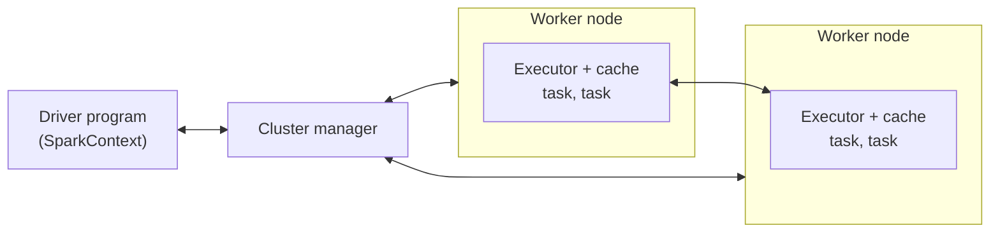
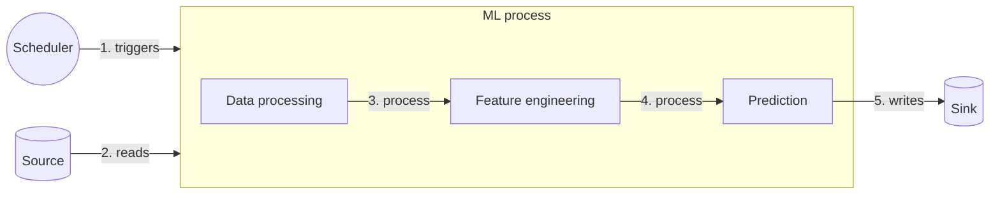

# EPRM-L02: Distributed Data Processing

> [!abstract] In short
> What do you do when the data no longer fits one core, one machine's memory, or one hour? **Scale only when you must:** pick the simplest tool that handles the data size and operations. **Store analytical data in columns:** backend (OLTP) stores fetch single records by key, analytics (OLAP) reads a few columns of millions of rows, and columnar Parquet files let a job read only what it needs. **Split the work:** a mean over a terabyte becomes partial sums and counts on many machines, and Spark does the chunking and scheduling, plans lazily and runs one task per partition on its executors. **Design for crashes:** a daily batch pipeline can fail at the trigger, read, processing or write, and reading the delta between source and sink, saving intermediate results and trusting only acknowledged writes make each failure recoverable.
>
> There is no written exam: this feeds Assignment 2 (your own distributed or multi-core data processor), the course project and the TA questioning about your code.

## When one machine stops being enough

Standard Python runs your code on **one CPU core**. A typical laptop has around ten cores, so a plain script leaves nine idle. (From outside the course material: in standard CPython the global interpreter lock lets only one thread run Python bytecode at a time, so extra threads do not speed up CPU-bound work; multiprocessing, one interpreter per core, gets around it.) Three questions follow:

- Can I use the other nine cores to make processing faster?
- Can I use another, idle machine as well?
- My machine has 16 GB of memory. How do I process 100 GB of data?

The options form a line, ordered by how much **data size times latency requirement** (how much data, how fast) they can handle:

```
more data x tighter latency  ------------------------->
Single core        Multiprocessing      Distributed, GPU
GHz capped fast    cores capped         uncapped: add machines
```

**Vertical scaling** (a bigger machine) hits ceilings: clock speeds top out around 6 GHz, and the largest cloud instances have a couple of hundred virtual CPUs at hourly prices about two thousand times those of the smallest. **Horizontal scaling** (more machines) has no such ceiling.

So "how do you process 100 TB in an hour?" has a simple answer: with many machines. With three caveats: why do you need that much data at all, it will be expensive, and it will take extra effort.

## Pick the simplest tool that fits

Two questions decide the tool: is the data small or large, and are the operations simple or complex?

| | Small data | Large data |
|---|---|---|
| **Simple operations** | Python built-ins | Multi-core libraries (Polars), concurrency |
| **Complex operations** | Data processing libraries (pandas) | Distributed computing (Spark) |

Polars is a DataFrame library that uses all cores of one machine; concurrency means writing your own threads or processes. Taken in order of added complexity, the cells run: built-ins, pandas, Polars or concurrency, Spark.

The guiding idea is the difference between **essential complexity** (what the problem itself demands) and **accidental complexity** (what your solution adds on top). Spark on a 2 GB CSV adds a cluster, a scheduler and new ways to fail to a problem pandas solves in one line, and all of it has to be maintained.

> [!definition] Essential vs accidental complexity, as the course uses it
> A solution must only be as complex as the problem requires. Pick the simplest and easiest solution. Avoid concurrency, distributed computing and GPU computing as long as you can.

This is Brooks's distinction and the "write for today" rule from [[Clean Code]], applied to infrastructure.

## Where the data lives: OLTP and OLAP

Recall the ride-hailing example from week 1: the backend database is optimised for the app, and an analyst's big query causes latency spikes for users (on top of the access rights and governance questions). That conflict has a name.

**OLTP (online transaction processing)** stores serve the backend. The backend mostly works with transactional data, such as fetching one user's profile: a **wide** result (many columns, few rows), read or written quickly and atomically. **OLAP (online analytics processing)** is what analytics and ML training need: aggregates over huge numbers of records, a **tall** result (many rows, few columns), loaded in bulk by ETL jobs (extract, transform, load). Stores optimised for OLTP are not optimised for big analytical queries.

The course takes this comparison from Kleppmann's *Designing Data-Intensive Applications*:

| Property | OLTP | OLAP |
|---|---|---|
| Main read pattern | Few records per query, fetched by key | Aggregate over many records |
| Main write pattern | Low-latency writes from user input | Bulk import, ETL |
| Primarily used by | End users, via apps | Analytics |
| Data sizes | GBs to TBs | TBs to PBs |

The practical consequence for an ML pipeline: copy data out of the backend store into storage built for analytics, and run the heavy reads there. See [[OLTP vs OLAP]].

## Row and columnar layouts

**The archive example.** It is the 1970s and you keep many one-page documents. How should you shelve them so that you can gather what people ask for quickly? It depends on the requests.

- **Single requests:** about 100 requests a day, each for one to five documents by ID, with a catalogue mapping IDs to locations. Shelve by ID and walk straight to each one.
- **Bulk requests:** five to ten requests a day, each for 100 to 500 documents by topic. Shelving by ID would send you all over the building; shelve by topic and one request is one walk to one shelf.

Files on disk work the same way. A table with columns `age`, `username`, `signup_date` can be laid out in two ways:

```
Table: age (a), username (u), signup_date (d), users 1..5

Row layout:     a1 u1 d1 | a2 u2 d2 | ... | a5 u5 d5
Column layout:  a1 a2 a3 a4 a5 | u1 u2 u3 u4 u5 | d1 d2 d3 d4 d5
                \encoded chunk/ \encoded chunk/ \encoded chunk/
```

A **row layout** keeps each record together, which suits OLTP: fetch or write one user, all fields at once. A **column layout** keeps each column together, which suits OLAP: "average age per signup month" reads two columns and never touches `username`.

Each column is then **encoded** as one chunk. From outside the course material (the Parquet documentation): values of one column share a type and often repeat, so they compress far better than mixed rows. A `category` column with five distinct values becomes a small dictionary plus short integer codes, and runs of one value become (value, run length) pairs. Smaller files mean less disk and network traffic, usually what limits analytical jobs.

## Apache Parquet

A text file or CSV works, but CSV is a row format with no types and no index: to sum one column you parse every byte of every row. **Apache Parquet** is the columnar file format the course uses. See [[Apache Parquet]] for more.

Inside one Parquet file:

```
+------------------------------------------+
| magic number "PAR1" (4 bytes)            |
| Row group 0                              |
|   Column chunk a                         |
|     Page 0: header | repetition levels   |
|             | definition levels | values |
|     Page 1 ...                           |
|   Column chunk b ...                     |
| Row group 1 ...                          |
| Footer: file metadata                    |
|   version, schema, key/value pairs       |
|   per row group, per column: type, path, |
|   encodings, codec, number of values,    |
|   offset of first data page and index    |
|   page, compressed/uncompressed size     |
| footer length (4 bytes)                  |
| magic number "PAR1" (4 bytes)            |
+------------------------------------------+
```

- A **row group** is a horizontal slice of the table (a block of rows).
- Inside it, each column has its own **column chunk**, split into **pages**, the unit that gets encoded and compressed.
- The **footer** holds the metadata, so a reader reads the end of the file first, learns the schema and where each column chunk starts, and jumps straight to the chunks it needs.

From outside the course material (Parquet documentation): the column metadata also carries statistics such as the minimum and maximum value of each column chunk. A query for `amount > 100` can then skip every row group whose maximum is 100 or less without reading it. Repetition and definition levels encode nested fields and nulls.

**Partitioned folders.** A dataset is usually many Parquet files, split into folders by the value of a column. The course repository's transactions are partitioned by day:

```
data/
├── intermediate/
│   ├── features/
│   └── preprocessing/
└── trx/
    ├── chck_date_day=2019-01-01/
    │   ├── part-00000-...c000.snappy.parquet
    │   └── part-00001-...c000.snappy.parquet
    ├── chck_date_day=2019-01-02/
    └── ...
```

`snappy` is the compression codec. From the Spark documentation: the folder name becomes a column, and a filter on `chck_date_day` skips whole folders (partition pruning), so reading only the new days means reading only the new folders.

## Splitting one computation across machines

**The mean example.** Calculate the mean of a terabyte of float64 numbers. No single core does that quickly, so the data is cut into chunks and each worker gets one. With six numbers standing in for the terabyte:

```
[0.123, 1.456, 2.567, 3.678, 9.123, 7.123]
        |                |                |
   [0.123, 1.456]   [2.567, 3.678]   [9.123, 7.123]
        v                v                v
    worker 1         worker 2         worker 3
  sum 1.579, n 2   sum 6.245, n 2   sum 16.246, n 2
        \                |                /
         ---------> coordinator <---------
           (1.579 + 6.245 + 16.246) / 6 = 4.012
```

Each worker returns its **sum and count**, and the coordinator adds them up:

$$\bar{x} = \frac{\sum_{k=1}^{K} S_k}{\sum_{k=1}^{K} n_k}$$

where:
- $K$ is the number of chunks (workers)
- $S_k$ is the sum of the values in chunk $k$
- $n_k$ is the number of values in chunk $k$

Why sums and counts? The mean of the workers' means equals the overall mean only when every chunk has the same size. With chunks [1, 2, 3] and [10], the means are 2 and 10, their average is 6, but the true mean is 16/4 = 4. Sums and counts combine correctly for any chunk sizes, and each worker sends back just two numbers.

The arithmetic is the easy part. Doing this by hand, with pandas and your own processes, also means solving:

- How to chunk the data.
- Orchestration: which nodes are available, and what happens if one goes down mid-compute.
- How to get data to the nodes (compression, for example).
- Wide operations such as sorting, where every output depends on all the data.
- Which operation to run first (filter before anything else, to shrink the data early).
- Whether you need a custom algorithm for every new computation.

A tool solves these once. No free lunch: you still need to learn its details.

## Apache Spark: SQL in Python, on many machines

**Apache Spark** is the distributed engine the course uses (see [[Apache Spark]]). **PySpark** (Spark's Python API) reads like SQL written in Python: `select`, `when`, `groupBy` behave like their SQL counterparts. **SparkSQL** lets you write the same query as a SQL string. (From the Spark documentation: both go through the same optimiser, so the choice is about readability.) Spark is a stack of libraries on one engine:

```
Python Spark Connect client
Spark SQL and DataFrame | pandas API on Spark | Structured Streaming | MLlib (machine learning)
Spark Core and RDDs
```

An RDD (resilient distributed dataset) is Spark's low-level abstraction, a collection split into partitions; DataFrames are built on it.

The course code reads the transactions, keeps five columns and the rows since a start date, then computes a per-group z-score. The `join` line is added here so the snippet runs end to end (the course code's version of that step was not shown).

```python
from pyspark.sql import functions as F

data = (
    spark.read.parquet(PathsConfig.raw_data_path)
    .select(["chck_date", "payment_type", "category", "amount", "fraud"])
    .filter(F.col("chck_date") >= start_date)
)

stats = data.groupby(group_by_cols).agg(
    F.mean("amount").alias("mean"),
    F.stddev("amount").alias("std"),
)
data = data.join(stats, on=group_by_cols)   # bring each group's mean and std onto its rows
data = data.withColumn(
    z_score_col_name, (F.col("amount") - F.col("mean")) / F.col("std")
)
```

Note the brackets in the z-score, which the week 1 pandas version got wrong. One more gotcha: `F.stddev` is the sample standard deviation, which is `NULL` for a group with a single row, so that group's z-scores come out `NULL` without any error. The `groupby` statistics in SparkSQL:

```python
data.createOrReplaceTempView("trx")
stats = spark.sql("""
    SELECT category, AVG(amount) AS mean, STDDEV(amount) AS std
    FROM trx
    GROUP BY category
""")
```

## Narrow and wide operations

The course sorts Spark operations into four groups:

- **Narrow operations:** count, average, sample, arithmetic.
- **Wide operations:** group by, aggregate, join.
- **Filtering operations:** where, filter.
- **File and data management operations:** read, write, partition.

The narrow/wide split is what decides cost. From outside the course material (Spark documentation): in a **narrow** transformation each output partition depends on one input partition, so every executor works on its own data without talking to the others. Arithmetic on a column, filters and sampling are like this. A **wide** transformation needs data from many partitions in one place: to group by `category`, everything about one category must end up on the same executor. Spark does this with a **shuffle**: data is written out, sent across the network to the executor responsible for its key, and read back there. Shuffles are usually the most expensive step of a job.

Spark's plans also explain why count and average sit on the narrow list although a whole-dataset count combines every partition: as in the mean example, each partition computes a partial count or sum locally, and only those tiny results move (the plan shows a `partial_avg` step before a small exchange into one partition). A group by uses the same trick per key, but still shuffles the partials so that all of one key's partials meet on one executor, which with many keys is a lot of data. A sort, or a join of two large tables, moves the rows themselves. When one side of a join is small, such as the per-category `stats` above, Spark copies it to every executor instead (a **broadcast join**, automatic below 10 MB by default) and the large side stays put.

## Lazy evaluation: nothing runs until you ask for a result

Spark tries to optimise the job you send it. To do that it needs to see the whole job first, so it **does not execute any operation until an action asks for a result**, such as `collect`, `write`, `head`, `show` or `count`. Everything before that (`select`, `filter`, `withColumn`, `join`) only adds a step to a plan. The general idea is [[Lazy Evaluation]].

The demo:

```python
spark = SparkSession.builder.master("local[2]").getOrCreate()
data = spark.read.parquet("data/trx")
doubled_data = data.select((F.col("amount") * 2).alias("double_amount"))
filtered_data = doubled_data.filter(F.col("amount") > 100)
filtered_data.explain("formatted")   # prints the plan; computes nothing
print(filtered_data.head(5))         # the action: now Spark runs
```

The code doubles first and filters second. The physical plan (the tree is read from the bottom up) does something else:

```
== Physical Plan ==
* Project (4)
+- * Filter (3)
   +- * ColumnarToRow (2)
      +- Scan parquet (1)

(1) Scan parquet
    ReadSchema: struct<amount:double>
    PushedFilters: [IsNotNull(amount),
                    GreaterThan(amount,100.0)]
(3) Filter
    Condition: isnotnull(amount) AND amount > 100.0
(4) Project
    Output: amount * 2.0 AS double_amount
```

Three optimisations, all possible only because nothing ran early:

1. **The filter moved before the projection**, so only surviving rows get doubled.
2. **Only one column is read** (column pruning): `ReadSchema` has just `amount`, because nothing else is used. With Parquet's columnar layout, the other columns are never touched on disk.
3. **The filter is pushed into the scan** (predicate pushdown, shown as `PushedFilters`): the Parquet reader can use the row group statistics in each file's footer to skip row groups that cannot contain `amount > 100`.

Run line by line, the job would read every column, double every value and only then drop the rows that fail the filter.

A quirk of the demo: the filter refers to `amount`, which `doubled_data` no longer has. Spark resolves it from the step before; it works, but reads badly.

From outside the course material: a runtime error, such as a Python function failing on one bad value, surfaces only when an action runs, so the failing line is not always the line with the bug. A misspelt column name is still caught at once, because Spark checks each step against the schema.

## Driver, executors, tasks and partitions

A Spark application has three parts:



- The **driver** runs your program. It builds the plan, splits it into tasks and hands them out.
- The **cluster manager** allocates machines and resources (from outside the course material: Spark's own standalone manager, YARN or Kubernetes).
- **Executors** run on the worker nodes. Each runs **tasks** and keeps a cache of data in memory, and executors exchange data with each other during shuffles.

A **partition** is one slice of the data, and a **task** is one unit of work on one partition. The rule of thumb is one task per partition, plus tasks for other work.

`master("local[2]")` runs everything on your own machine with **two cores**, so at most two tasks run in parallel. In the demo the transactions folder holds 367 day folders, and Spark ran three jobs: listing the files (367 tasks, one per folder, two at a time), reading the Parquet schema (one task) and `head(5)` itself (one task). More cores means more tasks at once; more tasks than cores means tasks queue.

From outside the course material (Spark documentation): the listing and schema jobs ran at `spark.read.parquet`, before any action, because Spark lists the files and reads the schema straight away; only the data processing waits. `head(5)` needed one task because Spark tries one partition first and reads more only if it has not found five rows. And "partition" means two things: the folders of a partitioned dataset, and the slices Spark cuts when reading, which tasks work on. Spark sizes those slices by bytes, packing small files together and splitting big ones at `spark.sql.files.maxPartitionBytes` (128 MB by default), so thousands of tiny files cost scheduling overhead and one giant file still parallelises.

## Making failures recoverable

Your application will crash. How do you make sure the crash is recoverable?

**The scenario.** A fraud model scores transactions. Every day at 00:00 the previous day's transactions arrive; at 01:00 the job runs and predicts fraud or not for each one. The data never changes after arrival, so each transaction is predicted once. The pipeline:



The trigger, the read, the processing and the write can each break, and for each the lecturer contrasts a bad, sometimes an acceptable, and a good design.

### Failure on trigger

It is the holidays and the whole team is out for five days. The scheduler fails and the job does not run for four days. When you are back and fix it, five days of data are unprocessed. How do you process all of them, rather than just yesterday's?

- **Bad:** the code assumes how data arrives and when it is triggered, and reads only the previous day. You have to change the code and run it by hand for each missing day.
- **Acceptable:** rely on the scheduler and replay the missed triggers. This works most of the time. It fails at **cold start** (processing data from before the job's first release, which no trigger ever existed for), and migrations are painful.
- **Good:** the process **reads the delta between source and sink**, whatever time it starts, and keeps a **state of the latest processed timestamp**. It does not depend on the scheduler at all. The cost: a run after a long outage may take a long time.

"The delta between source and sink" means: everything in the source that has no result in the sink yet. A run after a normal day finds one day of data; a run after the holidays finds five; a first run ever finds all of history. One piece of code covers all three.

### Failure on read

The data arrives late. Your job starts reading while the arrival is still being written and gets half of the day.

- **Bad:** the same "previous day only" assumption. The rest of the day is never processed unless you notice and rerun by hand.
- **Acceptable:** replay triggers. But how would you even know the data was incomplete?
- **Good:** the same delta-plus-state design. It makes no assumption that the data is complete: what arrives after this run is simply part of the next run's delta. What it does not solve is corrupt data, which needs its own checks.

From outside the course material: Spark writes an empty `_SUCCESS` file into an output folder only once a write job has finished, so a reader can wait for that marker. The saved state is safer when it tracks when records *arrived*, or when the job compares keys between source and sink: with the transactions' own timestamps (event time), a record that arrives late with an early timestamp falls behind the saved state and is skipped forever. These designs also make the job **idempotent** (running it twice gives the same result as running it once): a second run finds an empty delta and writes nothing, so a nervous manual rerun cannot duplicate predictions.

### Failure on process

A bug crashes the run. The process takes days to complete, so now you wait days again.

- **Bad:** the long-running process is a single task with no checkpoints or intermediate data. Simpler, and fine for short pipelines, but all of it succeeds or all of it fails.
- **Good:** either (1) use **checkpoints**, where the result of each operation is stored automatically, so a replay resumes from the last one; or (2) split the process into several tasks that each save their output and read the previous task's, so you rerun only the failed task. The costs: you need intermediate storage, and **not the local hard disk** (the machine that crashed may not come back, and other workers cannot read it), and the design is more complex.

The repository's `data/intermediate/preprocessing/` and `data/intermediate/features/` folders hold such saved results.

From outside the course material (Spark documentation): Spark recovers from a lost executor by itself, recomputing the lost partitions from the plan that produced them. That covers machine failures within one run, and does nothing when your own code crashes the application.

### Failure on write

The run succeeds, but the connection breaks mid-write. Not all predictions reach the sink, and because the run is green, nobody notices.

- **Bad:** a "connectionless" write method (fire and forget, with no confirmation from the receiver). Writes are fast, but they can be inconsistent.
- **Good:** (1) write to a database system with **ACID** properties, and (2) base the run's success on **ACK/NACK**, the receiver's acknowledgement or negative acknowledgement of each write. A green run then guarantees that the results reached the target. The cost is latency, which for a batch job should not matter.

> [!definition] ACID
> - **Atomicity:** each transaction is either carried out completely, or the database reverts to the state before it started.
> - **Consistency:** the database is in a consistent state before and after the transaction.
> - **Isolation:** concurrent transactions do not interfere with each other.
> - **Durability:** a successful transaction is persisted even if the system then fails.

With ACK and NACK the sender keeps data until the receiver confirms it: data 1 gets an ACK, data 2 a NACK, so data 2 is sent again until it is acknowledged. If the write is one transaction, atomicity means a broken connection leaves the sink as it was, so a retry starts clean.

| Failure point | What goes wrong | Good design |
|---|---|---|
| Trigger | Days not processed | Read the source-sink delta, keep state |
| Read | Half the data read | Same: the rest joins the next delta |
| Process | Crash loses days of work | Checkpoints or tasks with saved outputs |
| Write | Partial write, green run | ACID sink, success only on ACK |

## What to be able to do

- Justify the simplest tool for a given data size and set of operations, using essential versus accidental complexity.
- Contrast OLTP and OLAP, and row and columnar layouts, and say why ML pipelines read from analytical storage.
- Describe a Parquet file and a partitioned Parquet folder, and what a reader can skip.
- Compute a distributed mean from partial sums and counts, and say why averaging means fails.
- Write the core PySpark patterns (read, select, filter, groupBy and agg, join, withColumn) and their SQL equivalent.
- Classify operations as narrow or wide, explain a shuffle, and read a physical plan.
- Explain the driver, cluster manager, executors, tasks and partitions, and what `local[2]` limits.
- For each failure point of a batch pipeline, explain the bad and good designs and their trade-offs.

## Exam questions

> [!exam]- Your dataset is 3 GB and fits in memory. Why not use Spark anyway?
> **Key points:** essential versus accidental complexity; Spark adds a cluster, scheduling, lazy plans and new failure modes; pandas or Polars handle the case; scale only when data size and latency demand it.
>
> The solution should only be as complex as the problem. A 3 GB dataset that fits in memory is small data: pandas handles complex operations on it and Polars can use every core of the machine for simple ones. Spark would add accidental complexity: a session and cluster to configure, lazy plans to debug, partitions and shuffles to tune, and more things that can fail, while solving nothing pandas cannot. The course's rule is to avoid concurrency, distributed computing and GPU computing as long as you can, and move along the line from single core to multiprocessing to distributed computing only when data size and latency requirements push you there.

> [!exam]- How would you compute the mean of a dataset spread across several machines, and why not average the machines' means?
> **Key points:** split the data into chunks; each worker computes a local sum and count; the coordinator divides the total sum by the total count; averaging means is only correct for equal-size chunks; only two numbers per worker cross the network.
>
> Split the data into chunks and give each worker one. Each worker computes the sum $S_k$ and count $n_k$ of its chunk and sends only those two numbers back. The coordinator computes $\sum_k S_k / \sum_k n_k$. Averaging the workers' means gives the right answer only when every chunk has the same size: with chunks [1, 2, 3] and [10] the means are 2 and 10, their average is 6, but the true mean is 4. Sending sums and counts is also cheap, because the raw data never moves. In Spark terms, this is why a global average is cheap: partial results are computed locally per partition and only those are combined.

> [!exam]- Why does your pipeline store its data as partitioned Parquet instead of CSV?
> **Key points:** columnar layout reads only needed columns; per-column encoding compresses well; footer metadata and statistics let readers skip row groups; partition folders let readers skip whole days; types and schema are stored.
>
> Analytical and ML jobs read a few columns of many rows, the OLAP pattern. CSV is a row format: to use one column you parse every byte of every row, and nothing says what type a field is. Parquet stores each column of a row group as a separate chunk, so a reader fetches only the columns it uses. Values of one column are similar, so they encode and compress well, which cuts disk and network traffic. The footer holds the schema, the location of each column chunk and statistics such as minimum and maximum values, so a filter can skip row groups that cannot match. Partitioning the folder by day (`chck_date_day=...`) lets a reader skip whole days, which also makes reading only new data cheap.

> [!exam]- What is the difference between OLTP and OLAP, and why should an ML training job not query the app's backend database directly?
> **Key points:** OLTP serves the backend: few records by key, low-latency writes, wide results; OLAP serves analytics: aggregates over many records, bulk loads, tall results; backend stores are optimised for OLTP; big queries cause latency spikes for users.
>
> OLTP (online transaction processing) is the backend's workload: fetch or update a few records by key, such as one user's profile, with low-latency writes from user input, returning wide results (many columns, few rows). OLAP (online analytics processing) is the analytics workload: aggregate over huge numbers of records, loaded in bulk by ETL, returning tall results (many rows, few columns), on TBs to PBs of data. A backend database is laid out and tuned for OLTP, typically row-wise. A training job's full-history scan is slow there and competes with the app's own queries, causing latency spikes for real users, whose requests take priority. So the data is copied out to storage built for analytics, such as Parquet files, and the heavy reads happen there.

> [!exam]- Which of your Spark operations are narrow and which are wide, and why does it matter?
> **Key points:** narrow: each output partition needs one input partition, no data movement (arithmetic, filter, sample); wide: needs rows from many partitions (groupBy, join, sort); wide triggers a shuffle through disk and network; shuffles dominate cost; global count/avg only move partial results.
>
> In a narrow operation every partition can be processed on its own executor without seeing other data: column arithmetic like the z-score `withColumn`, filters, sampling. In a wide operation an output depends on rows spread over many partitions: a groupBy needs all data for one key together (Spark first reduces each partition to partial aggregates per key), a join needs matching keys together, a sort needs global order. Spark meets that with a shuffle: rows are written out, sent over the network to the executor that owns their key, and read back. That is usually the most expensive part of a job, so you filter and select before grouping or joining, to shuffle less data. A join with a small table, such as per-group statistics, avoids shuffling the large side, because Spark broadcasts the small table to every executor. A whole-dataset count or average is cheap despite combining all partitions, because each partition sends only its partial count or sum.

> [!exam]- When does Spark actually execute your code, and what does it gain from waiting?
> **Key points:** transformations only build a plan; actions (head, collect, count, show, write) trigger execution; seeing the whole plan lets Spark optimise; filter reordering, column pruning and predicate pushdown into Parquet; explain() shows the plan.
>
> Spark is lazy. Transformations such as `select`, `filter`, `withColumn` and `join` return immediately and only add steps to a plan. Execution starts when an action needs a result: `head`, `collect`, `count`, `show` or `write`. Because Spark sees the whole plan first, it can optimise it. In the demo the code doubled `amount` and then filtered on it, but the physical plan filtered first, read only the `amount` column from Parquet (column pruning), and pushed the `amount > 100` condition into the Parquet scan (predicate pushdown), where row group statistics can skip data. `explain("formatted")` shows that plan without running anything. A practical consequence: a runtime error surfaces only at the action, so the line that fails is not always the line with the bug, although a misspelt column name is caught at once.

> [!exam]- Your Spark job runs with master("local[2]") and has 367 tasks to run. What happens, and what would change on a cluster?
> **Key points:** local[2] means everything on one machine with two cores; at most two tasks run at once, the rest queue; roughly one task per partition; driver plans and schedules, executors run tasks; a cluster adds executors on worker nodes via the cluster manager.
>
> `local[2]` runs everything on your own machine with two cores, so at most two tasks run in parallel and the other tasks wait in a queue. Spark creates roughly one task per partition, plus tasks for work such as listing files and reading the schema. On a cluster, the driver still builds the plan and splits it into tasks, but a cluster manager gives it executors on several worker nodes, each running several tasks in parallel and caching data, and exchanging data with each other in shuffles. More executor cores means more tasks at once; more tasks than cores just means tasks queue. Very many tiny partitions waste time on scheduling, which is why Spark packs small files together when reading.

> [!exam]- Your daily scoring job did not run for four days. How does your design recover without code changes?
> **Key points:** do not hard-code "process yesterday"; read the delta between source and sink; keep state of the latest processed timestamp; independent of the scheduler; cold start and backfills handled; cost is a long catch-up run.
>
> A job that reads only the previous day would need code changes and manual runs for each missing day. Replaying the scheduler's missed triggers works most of the time, but it cannot handle a cold start (data from before the first release, for which no trigger exists) and makes migrations painful. My job instead reads the delta: everything in the source that has no result in the sink yet, found using a saved state with the latest processed timestamp. Whenever it starts, it processes what is missing: one day normally, five days after the outage, all history on the first run. The trade-off is that a catch-up run can take a long time. Because a second run finds an empty delta, the job is also idempotent: rerunning it does not duplicate predictions.

> [!exam]- Your job ran for two days and then crashed on a bug. How would you design it so you do not lose two days?
> **Key points:** a single long task is all-or-nothing; use checkpoints that store each operation's result; or split into tasks that save and read intermediate results; rerun only the failed part; intermediate storage must be shared and durable, not the local disk; costs complexity.
>
> As a single task with no intermediate data, the job either completely succeeds or completely fails, which is fine for short pipelines and painful for long ones. Two fixes: checkpoints, where each operation's result is stored automatically and a replay resumes from the last one; or splitting the pipeline into tasks (preprocessing, features, prediction) that each write their output to intermediate storage and read their input from the previous task's output, so only the failed task reruns. The intermediate storage must not be the local hard disk: the crashed machine may be gone and other workers cannot read it. The price is storage and a more complex design. Spark itself recomputes lost partitions when an executor dies, but that does not survive the application crashing.

> [!exam]- The run was green but half the predictions are missing from the sink. How did that happen and how do you prevent it?
> **Key points:** connection broke mid-write; a fire-and-forget write never learns of the failure; use an ACID sink so a broken write rolls back; mark success only on ACK, retry on NACK; latency cost is acceptable for batch.
>
> The processing succeeded but the connection broke during the write. With a connectionless, fire-and-forget method, the writer never learns which writes failed, so the run reports success. Two fixes: write to a database with ACID properties, so a transaction either commits completely or is rolled back (atomicity) and a committed one survives failures (durability); and make the run's success depend on acknowledgements, so a NACK or missing ACK triggers a retry or fails the run. Then a green run means the results reached the target. Waiting for acknowledgements adds latency, which a batch job can afford.

## Flashcards

> [!card]- Why do extra threads not speed up CPU-bound Python code in standard CPython?
> The global interpreter lock lets one thread run Python bytecode at a time.

> [!card]- What limits each step of single core, multiprocessing, distributed computing?
> Clock speed caps a core; core count caps a machine; distributed computing is uncapped.

> [!card]- What is the difference between vertical and horizontal scaling?
> Vertical: a bigger machine. Horizontal: more machines.

> [!card]- Which tool fits small data with complex operations, in Yesilbek's grid?
> A data processing library such as pandas.

> [!card]- Which tool fits large data with simple operations, in Yesilbek's grid?
> Multi-core libraries such as Polars, or concurrency.

> [!card]- Which tool fits large data with complex operations, in Yesilbek's grid?
> Distributed computing, such as Spark.

> [!card]- What is accidental complexity?
> Complexity your solution adds beyond what the problem itself requires.

> [!card]- Which three things should you avoid as long as you can, according to Yesilbek?
> Concurrency, distributed computing, GPU computing.

> [!card]- What is the main read pattern of OLTP?
> A small number of records per query, fetched by key.

> [!card]- What is the main write pattern of OLAP?
> Bulk import, ETL.

> [!card]- Is a typical OLTP result wide or tall?
> Wide: many columns, few rows.

> [!card]- Why should analytics not run heavy queries on an OLTP store?
> It is optimised for the backend; big queries cause latency spikes for users.

> [!card]- In the 1970s archive example, how should you shelve documents requested in bulk by topic?
> By topic, so one request is one trip to one shelf: the columnar idea.

> [!card]- Why does a columnar layout suit analytical queries?
> A query reads only the few columns it needs and skips the rest.

> [!card]- Why do columnar files compress better than row files?
> Each chunk holds one column's values: same type, often repetitive.

> [!card]- What are the main parts of a Parquet file, from outer to inner?
> Row groups, column chunks, pages; plus a footer with metadata.

> [!card]- Why is Parquet's metadata in a footer at the end of the file?
> A reader reads it first and then jumps straight to the column chunks it needs.

> [!card]- What lets a Parquet reader skip row groups for a filter like amount > 100?
> Minimum and maximum statistics per column chunk in the footer metadata.

> [!card]- What does a folder name like chck_date_day=2019-01-01 do in a Parquet dataset?
> Partitions by day; a filter on that column skips whole folders.

> [!card]- In a distributed mean, what does each worker send back?
> Its chunk's sum and count.

> [!card]- When does averaging the workers' means give the correct overall mean?
> Only when all chunks have the same size.

> [!card]- What is the difference between PySpark and SparkSQL?
> PySpark is Spark's Python DataFrame API; SparkSQL writes the same query as SQL.

> [!card]- What does F.stddev return for a group with a single row?
> NULL, because it is the sample standard deviation.

> [!card]- What is a narrow transformation in Spark?
> One where each output partition depends on one input partition: no data movement.

> [!card]- Give three wide operations in Spark.
> Group by, aggregate, join.

> [!card]- What is a shuffle?
> Redistributing rows across executors by key, through disk and network, for a wide operation.

> [!card]- Why is a global count or average cheap even though it combines all partitions?
> Each partition sends only a partial count or sum.

> [!card]- How does a broadcast join avoid shuffling the large table?
> Spark copies the small table to every executor, so the large side stays put.

> [!card]- When does Spark execute a chain of transformations?
> Only when an action needs a result, such as head, collect, count or write.

> [!card]- Why is Spark's evaluation lazy?
> Seeing the whole job first lets it optimise the plan before running anything.

> [!card]- What is predicate pushdown?
> Applying a filter inside the file scan, so data can be skipped at read time.

> [!card]- What does ReadSchema with only one column show in a Spark plan over Parquet?
> Column pruning: Spark reads only the columns the query uses.

> [!card]- Why can a bug in a Spark transformation crash a later line?
> Runtime errors surface only when an action runs the plan.

> [!card]- What does the Spark driver do?
> Runs your program, builds the plan, splits it into tasks and schedules them.

> [!card]- What runs on a Spark worker node?
> An executor that runs tasks and caches data.

> [!card]- What is the relationship between Spark tasks and partitions?
> Roughly one task per partition, plus tasks for work like listing files.

> [!card]- With master("local[2]"), how many tasks run in parallel?
> Two.

> [!card]- Why does spark.read.parquet start jobs before any action?
> It lists the files and reads the schema straight away; only data processing waits.

> [!card]- What are the four points where a batch ML pipeline can fail?
> Trigger, read, process, write.

> [!card]- What is the good design for a missed trigger?
> Read the delta between source and sink, keeping state of the latest processed timestamp.

> [!card]- Why does replaying scheduler triggers fail at cold start?
> Data from before the first release never had a trigger to replay.

> [!card]- What does "the delta between source and sink" mean?
> Everything in the source that has no result in the sink yet.

> [!card]- What does it mean for a pipeline run to be idempotent?
> Running it twice gives the same result as running it once.

> [!card]- Why should a timestamp state track arrival time rather than event time?
> Late records with early event times would fall behind the state and be skipped.

> [!card]- What is the downside of running a long pipeline as one task without checkpoints?
> All succeeds or all fails: a crash loses all progress.

> [!card]- Why must intermediate results not live on the local hard disk?
> The crashed machine may be gone, and other workers cannot read it.

> [!card]- Why can a write failure leave a green run?
> A connectionless write never learns that the write failed.

> [!card]- What does atomicity guarantee for a database write?
> The transaction completes fully, or the database reverts to its state before it.

> [!card]- What does durability guarantee?
> A successful transaction survives a later system failure.

> [!card]- What should a run's success be based on when writing results?
> ACK/NACK from the receiver: success only when every write is acknowledged.

## Links

- **Course:** [[EPRM - Overview|Course overview]]
- **Previous lecture:** [[EPRM-L01 - Data Roles, ML Lifecycle, Clean Code and Unit Testing]] (the ride-hailing example and the backend database problem)
- **Concepts:** [[Apache Spark]] · [[Apache Parquet]] · [[OLTP vs OLAP]] · [[Lazy Evaluation]] · [[MLOps]] · [[Clean Code]]
- **Source:** lecture slides, "Week 2: Distributed Data Processing", Kemal T. Yesilbek, 4 November 2026. The PySpark snippets, the physical plan and the Spark UI observations are from the code shown in the lecture, from `kemalty/uva-mlprod-code` (branch `v4`).
- **Readings for the week:** Martin Kleppmann, *Designing Data-Intensive Applications* (1st edition, O'Reilly, 2017), Chapters 3 (storage and retrieval), 4 (encoding and evolution), 6 (partitioning) and 7 (transactions). The OLTP versus OLAP table is from the book. Spark quick start, https://spark.apache.org/docs/latest/quick-start.html, and RDD programming guide, https://spark.apache.org/docs/latest/rdd-programming-guide.html.
- **Further (used for the additions marked as outside the course material):** Apache Parquet file format documentation, https://parquet.apache.org/docs/file-format/ (file layout figure: https://github.com/apache/parquet-format). Spark SQL performance tuning and data sources guides, https://spark.apache.org/docs/latest/sql-performance-tuning.html. Spark cluster mode overview, https://spark.apache.org/docs/latest/cluster-overview.html. Row versus column layout figure: Dremio, "Intro to Apache Parquet", https://www.dremio.com/resources/guides/intro-apache-parquet/. ACK/NAK figure: Ian Finlayson, CPSC 414 notes, https://ianfinlayson.net/class/cpsc414/notes/09-transport2.
