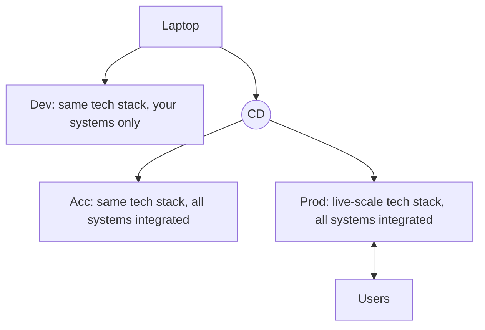
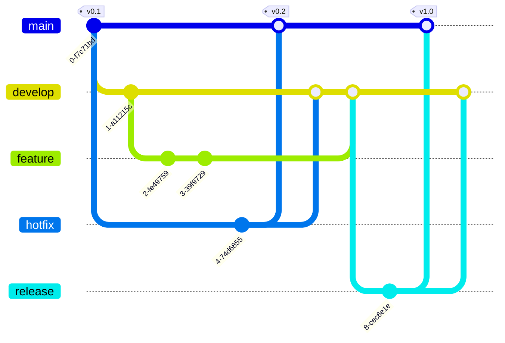

# EPRM-L03: Containerization and Software Engineering Processes

> [!abstract] In short
> How do you get code that works on your laptop to run the same way everywhere, and how do you stop a team's mistakes from reaching real users? Machines differ in architecture, operating system, configuration and packages, so even a one-line hello world can break elsewhere. A **container** packs the application with everything it needs and runs it isolated on the host's operating system, which makes it far lighter than a virtual machine. An ML application also talks to databases, MLflow and cloud storage, which mocked unit tests cannot check; **integration tests** can, with each dependency in its own container, wired together by Docker Compose. Mistakes are inevitable, so processes keep them out of production: development, acceptance and production environments, GitFlow branches mapped onto them, reviewed pull requests, and technical debt taken on only deliberately.
>
> There is no written exam: this feeds Assignment 3 (debugging a Docker container, and adding SQL through Docker Compose), the course project and the TA questioning about your code.

## Software needs a package

How do you ship a product from the Netherlands to the US? Whatever the vehicle, you package it. The package's core job is to **separate the product from the shipping process**: the carrier does not need to know what is inside, it takes the box and moves it to the address on the label.

Software needs the same mechanism. You want to package your code and ship it to whatever the end point is: a bare-metal server, a cloud compute instance, a phone. Software deployment is much harder than shipping a box, and **containerization** is the latest answer.

## "It works on my machine"

There is no single computer. Machines of the same brand run different operating systems, different versions of them, set up in different ways, and all of that changes how programs run. You might think this only matters for big, complex code. It does not.

**The hello world example.** The lecturer, Kemal Yesilbek, ran the same line in two containers, one with Python 2.7 and one with Python 3.13:

```text
$ docker run -it --entrypoint /bin/bash python:2.7.11-slim
root@5fa35c9439e2:/# python --version
Python 2.7.11
root@5fa35c9439e2:/# python -c "print('hello', flush=True)"
  File "<string>", line 1
    print('hello', flush=True)
                        ^
SyntaxError: invalid syntax
root@5fa35c9439e2:/# python -c "print('hello')"
hello

$ docker run -it --entrypoint /bin/bash python:3-slim
root@58919815cced:/# python --version
Python 3.13.5
root@58919815cced:/# python -c "print('hello', flush=True)"
hello
```

The `flush` keyword tells Python to push the text out of its buffer immediately, so it appears on the terminal at once. It was introduced in Python 3.3. A colleague on a newer Python writes perfectly legitimate code with it, and on your older interpreter that code does not run. (From outside the course material: the error on 2.7 is a syntax error because in Python 2 `print` is a statement, so `print('hello')` only works because the brackets are read as grouping one value.)

That example is small, but realistic. Differences can sit at every level:

```text
Architecture  ->  OS and version  ->  OS configuration  ->  Packages and versions
(x86_64, ARM)     (Windows, Linux)    (settings, setup)     (dependencies)
```

Each level can change how the code executes and what it returns. A real case from NumPy's issue tracker (issue 21209, "float32 differences between x86_64 (intel) and arm64 (M1 pro)"): the same Python, pandas and NumPy versions (1.22.3) gave different `float32` results on Intel and Apple M1 machines, while `float64` results matched. Same code, same packages, different hardware, different numbers.

So how do you make sure code runs everywhere, runs the same and gives the same result? One way is to make your laptop the server and ship your laptop. The meme version: "It works on my machine." "Then we'll ship your machine." "And that is how Docker was born."

## From servers to virtual machines to containers

You have an app and want to bring it to the live environment. There have been three ways of doing it.

| Way before | Virtual machines | Containers |
|---|---|---|
| Obtain servers | Obtain servers | Obtain servers |
| Configure servers | Select a hypervisor | Select an orchestrator |
| Move code onto the server | Select a VM type | Create containers |
| Install dependencies | Create images | Push them to a registry |
| Spin up the app | Deploy the VM on the server | Deploy to the orchestrator |
| Check resources constantly | It brings the entire OS with it | Forget about servers |
| You had Linux version A, the server B | Messes up your machine, weird memory errors | Runs anywhere exactly the same |

A **hypervisor** is the software that runs virtual machines on a physical machine. An **orchestrator** is the system that runs containers on a pool of machines and keeps them running (Kubernetes, in week 6). A **registry** is a store of container images that servers pull from, like a package index for whole applications. (Strictly, what you push is the container's image, explained below.)

A virtual machine solves the same problem as a container, by packing a whole computer. The main difference: **VMs are heavy because each brings its own operating system; containers are light because they run on the host's existing operating system.** VMs therefore waste resources: instead of every app bringing its own OS, containers share one. (From outside the course material: a VM also takes minutes to boot, a container seconds.) Isolation is the other gain: one container is one application instance, neatly separated from the rest.

```text
  Virtual machines                    Containers
+-------+-------+-------+     +-----+-----+-----+-----+
| App A | App B | App C |     |App A|App B|App C|App D|
| libs  | libs  | libs  |     |libs |libs |libs |libs |
|Guest  |Guest  |Guest  |     +-----+-----+-----+-----+
|  OS   |  OS   |  OS   |     |   Container engine    |
+-------+-------+-------+     |      (Docker)         |
|      Hypervisor       |     +-----------------------+
+-----------------------+     |   Host operating      |
|  Host OS / hardware   |     |   system              |
+-----------------------+     +-----------------------+
                              |   Infrastructure      |
                              +-----------------------+
```

## How a container works

A container:

- **uses the resources of the host system** (its CPU, memory and operating system);
- behaves **like an isolated machine inside the host machine**;
- is **isolated**: it cannot access or interfere with the host, and is agnostic to it. You cannot mess up the host even if you try.

> [!definition] Container, as the course puts it
> A container is like an isolated machine that uses the resources of the host machine. We build the container and ship it to an orchestrator, and it works everywhere the same.

See [[Containerization]] for the general concept and [[Docker]] for the tool.

From outside the course material (Docker documentation and Linux background), the parts the course leaves implicit:

- An **image** is the package: a read-only file system snapshot (base OS files, Python, your libraries, your code) plus metadata such as the default command. A **container** is a running instance of an image, with a thin writable layer on top. Many containers can run from one image, and what a container writes is lost when it is removed, unless it goes to a mounted **volume**.
- An image is built in **layers**, one per build instruction, and layers are cached: change one line of code and only the layers from that instruction on are rebuilt.
- Isolation comes from two Linux kernel features. **Namespaces** limit what a process can see (its own process list, network, file system and hostname). **Control groups (cgroups)** limit how much it can use (CPU, memory). A container is an ordinary process on the host, fenced in by these.
- Because containers share the host's kernel, "the same everywhere" has limits. A Linux image needs a Linux kernel: Docker Desktop on macOS and Windows runs a small Linux VM underneath. And an image is built for one CPU architecture: on an Apple Silicon Mac you build `arm64` images by default, so the NumPy problem above can still bite unless you build for the server's platform (`--platform linux/amd64`).
- Isolation is the default, and you can open it on purpose: a mounted host folder, a published port or `--privileged` gives the container access to the host. Sharing a kernel also makes the isolation weaker than a VM's.

## Docker in practice

The lecture's live coding built and ran containers from the course repository, whose code was not available for this note. What follows is from outside the course material (Docker documentation), written to fit the repository layout from [[EPRM-L01 - Data Roles, ML Lifecycle, Clean Code and Unit Testing|week 1]], where the Dockerfile lives in `infra/`.

**A Dockerfile** is the recipe for an image, read from top to bottom:

```dockerfile
# base image: Debian plus Python 3.13
FROM python:3.13-slim
# all later paths are relative to /app
WORKDIR /app
# dependencies first: this layer stays cached
COPY requirements.txt .
RUN pip install --no-cache-dir -r requirements.txt
# code last: it changes most often
COPY src/ src/
COPY models/ models/
# print output straight away (the flush problem)
ENV PYTHONUNBUFFERED=1
# default command when a container starts
CMD ["python", "src/main_training.py"]
```

Why this order: each instruction is a layer, and a changed layer invalidates every layer after it. With `requirements.txt` copied and installed before the code, editing `src/` reuses the cached install, and rebuilds take seconds. Copy everything first and every code edit reinstalls every package.

Pin the base image tag. The demo's `python:3-slim` resolved to Python 3.13.5 on that day and will resolve to something newer next year, which is the "works on my machine" problem coming back through the door. A `.dockerignore` file keeps `data/`, `.venv/` and `.git/` out of the build context, so they are not sent to the builder or copied into the image.

**Building and running:**

```bash
docker build -t fraud-model:0.1 -f infra/Dockerfile .   # "." = build context (repo root)
docker run --rm fraud-model:0.1                         # run the default command
docker run --rm -p 8000:8000 fraud-model:0.1            # publish container port 8000 on the host
docker run --rm -v "$(pwd)/data:/app/data" fraud-model:0.1   # mount host data into the container
docker run --rm -e MLFLOW_TRACKING_URI=http://host.docker.internal:5000 fraud-model:0.1
```

**Debugging a container that misbehaves:**

```bash
docker ps -a                       # list containers, including ones that exited
docker logs <container>            # its stdout and stderr: usually the traceback
docker exec -it <container> bash   # open a shell inside a running container
docker run -it --entrypoint /bin/bash fraud-model:0.1   # start a shell instead of the app
docker image inspect fraud-model:0.1   # default command, env vars, working directory
```

The `--entrypoint /bin/bash` run is the trick from the hello world demo: land in a shell inside the image and check by hand whether the files, versions and paths are what you expect. Common causes of a broken container:

- **It exits at once.** A container lives exactly as long as its main process. If the script finishes or crashes, the container stops; `docker logs` shows why.
- **File not found.** The file was never copied in (missing `COPY`, or excluded by `.dockerignore`), or a relative path assumes a different working directory than `WORKDIR`.
- **The API runs but cannot be reached.** It listens on `127.0.0.1`, which inside a container is the container itself. It must listen on `0.0.0.0`, with the port published by `-p`.
- **`localhost` points at the wrong place.** For the same reason, reach another container by its service name (Docker Compose, below) and the host by `host.docker.internal` on Docker Desktop.
- **No output appears.** Python buffers output when it is not writing to a terminal; set `PYTHONUNBUFFERED=1` or use `flush=True`.

## MLflow: tracking experiments and models

**MLflow** is a tool for three jobs:

- **Experiment tracking:** record each training run with its parameters, metrics and output files, so you can compare runs and reproduce the best one.
- **Model registry and management:** keep versions of trained models in one place.
- **Model serving:** expose a registered model behind an API.

It is popular, and in the lecturer's words definitely optional for more than 90% of projects. The course uses it to log three things per run: the **model** (the model file as a pickle), an **artifact** (any file) and a **metric** (the F1 score). In the demo, a run of experiment "Alpha" shows the metrics `test_f1_mean` (0.68) and `test_f1_std`, and two artifacts: `alpha.pkl`, the pickled model, and `cv_scores.json`, the per-fold fit and score times and train and test precision, recall and F1.

See [[MLflow]] for more. The demo's code was not available. Below, from outside the course material (MLflow documentation), is one way to log the same three things. The `cv_scores.json` keys match what scikit-learn's `cross_validate` returns with training scores on and precision, recall and F1 scoring, so the demo probably used it (an inference).

```python
import json, pickle
import mlflow
from sklearn.model_selection import cross_validate

mlflow.set_tracking_uri("http://localhost:5000")   # the MLflow server
mlflow.set_experiment("Alpha")

with mlflow.start_run():
    scores = cross_validate(model, X, y, cv=5, return_train_score=True,
                            scoring=["precision", "recall", "f1"])
    mlflow.log_metric("test_f1_mean", scores["test_f1"].mean())
    mlflow.log_metric("test_f1_std", scores["test_f1"].std())

    with open("cv_scores.json", "w") as f:
        json.dump({k: str(v) for k, v in scores.items()}, f)
    mlflow.log_artifact("cv_scores.json")             # any file

    model.fit(X, y)
    with open("alpha.pkl", "wb") as f:
        pickle.dump(model, f)
    mlflow.log_artifact("alpha.pkl")                  # the model as a pickle
```

The MLflow server is itself just another service, which you can start in its own container and point the training container at through `MLFLOW_TRACKING_URI`. That makes it one of the external systems in the next section.

## Your application is never alone

Unless you are building a demo, your application is never the only software. A Python ML application typically sends SQL queries to a database, logs runs to an MLflow tracking server and uploads files to cloud storage. These systems will not run on your machine in production, so you have to build, and test, with external dependencies.

[[Unit Testing]] covers the units of your own code, with external dependencies mocked. But how can you be sure that the SQL you wrote is actually correct? Take `SELECT * FR0M table WHERE a>b`, with a zero in place of the O in FROM. A mock returns whatever rows you tell it to, so that query passes every unit test, and so do a wrong column name and a type mismatch with the real table.

### The testing pyramid

> [!definition] Three levels of tests
> - **Unit tests** test your code.
> - **Integration tests** test your code's integration and interaction with other systems.
> - **End-to-end (E2E) tests** simulate the user's interaction, taking the system as a whole from input to output.
>
> All of them must be **automated**.

```text
            /\
           /  \        UI / end-to-end tests   (few)
          /----\
         /      \      integration tests
        /--------\
       /          \    unit tests              (many)
      /------------\
```

Moving up the pyramid, tests become **more difficult to implement** and it becomes **more difficult to find the root cause** of a failure: a failing unit test points at one function, a failing end-to-end test only says that something somewhere is wrong. So you write many unit tests, fewer integration tests (for example, the function that queries the database, run against a database) and a few end-to-end tests. Yesilbek's own view: with AI-assisted engineering, testing, especially UI and end-to-end tests, is much more important now.

See [[Integration Testing]].

### Automating integration tests: more containers

The FIRST rules from week 1 say tests must be isolated and repeatable. An integration test, though, needs a real database. A shared development database fails both rules: other people change its data, and from a test machine you often cannot guarantee access to the tools in the test or development environments, or connect to them at all.

The answer is more containers. Put each external dependency in its own container and set it up exactly as the test expects. Containers are the modern way of deployment, so an image very likely exists already for each dependency, external (PostgreSQL, Redis, MLflow) or internal to your company. **Docker Compose** offers light orchestration of containers: one `docker-compose.yml` file describes several services (a web app, a database, a cache), and `docker compose up` starts them all on a shared network.

From outside the course material (Docker Compose documentation), an integration test setup with a PostgreSQL database, the compose file sitting in `infra/`:

```yaml
services:
  db:
    image: postgres:16
    environment:
      POSTGRES_USER: test
      POSTGRES_PASSWORD: test        # throwaway test credentials only
      POSTGRES_DB: trx
    healthcheck:
      test: ["CMD-SHELL", "pg_isready -U test -d trx"]
      interval: 2s
      retries: 15
  tests:
    build:
      context: ..                    # repo root, relative to infra/
      dockerfile: infra/Dockerfile
    volumes:
      - ..:/app                      # mount the repo, so tests/ is inside
    environment:
      DATABASE_URL: postgresql://test:test@db:5432/trx   # "db" = the service name
    depends_on:
      db:
        condition: service_healthy   # wait until Postgres accepts connections
    command: ["python", "-m", "pytest", "tests/integration"]
```

```python
# src/data_processing/queries.py
import pandas as pd
from sqlalchemy import text

def fetch_large_transactions(engine, min_amount):
    query = text("SELECT id, amount FROM trx WHERE amount > :m")
    return pd.read_sql(query, engine, params={"m": min_amount})

# tests/integration/test_queries.py
import os
import pytest
from sqlalchemy import create_engine, text
from src.data_processing.queries import fetch_large_transactions

@pytest.fixture
def engine():                                   # setup: a known table
    eng = create_engine(os.environ["DATABASE_URL"])
    with eng.begin() as conn:
        conn.execute(text("DROP TABLE IF EXISTS trx"))
        conn.execute(text("CREATE TABLE trx (id INT, amount FLOAT, fraud INT)"))
        conn.execute(text("INSERT INTO trx VALUES (1, 50, 0), (2, 150, 1), (3, 300, 0)"))
    yield eng
    eng.dispose()

def test_fetch_large_transactions(engine):      # collect and compare
    result = fetch_large_transactions(engine, min_amount=100)
    assert sorted(result["id"]) == [2, 3]
```

```bash
docker compose -f infra/docker-compose.yml up --build \
    --abort-on-container-exit --exit-code-from tests
docker compose -f infra/docker-compose.yml down -v      # remove containers and data
```

The details that usually go wrong:

- **Service names are host names.** Inside the compose network the database is `db:5432`; `localhost` in the `tests` container is the `tests` container itself.
- **Started is not ready.** Plain `depends_on` only waits for the database container to start, and Postgres needs a few seconds more to accept connections. The health check plus `condition: service_healthy` waits for readiness.
- **The test container needs the tests.** The Dockerfile above copies only `src/` and `models/`, so the compose file mounts the repository into `/app`. `pytest` and the Postgres driver (`psycopg2-binary`) must be in `requirements.txt`, and `python -m pytest` puts `/app` on the import path so `from src...` works.
- **Clean state per run.** The fixture creates its own table, and `down -v` deletes the database volume, so every run starts from the same state: the test is repeatable.
- `--exit-code-from tests` makes the command's exit code the test result, so a CI pipeline (an automated build and test server) fails when the tests fail.

## Mistakes happen, just not in production

In June 2021 some HBO Max subscribers received a mysterious email with the subject line "Integration Test Email #1". Hours later the company said it was intended to be an empty test email, and "yes, it was the intern."

Whose fault is this: the intern, the manager, HR, or the engineering processes? The lecturer's answer is **the engineering processes**. Mistakes happen. They just cannot be allowed to happen in live environments. A process in which a test email can reach real subscribers is broken, whoever pressed the button.

## Dev, Acc, Prod: layered environments

[[EPRM-L01 - Data Roles, ML Lifecycle, Clean Code and Unit Testing|Week 1]] introduced the layered environments: pressing a button that makes changes live is a bad idea, each environment runs the same tech stack, and only production is live and protected. This lecture adds what each one is for. See [[Development, Acceptance and Production Environments]].

**Local (your laptop).** Unrestricted and personal: the easiest place to develop and debug.

**Development (Dev), also called Test.** A disorganised free-for-all, used mostly to develop against the tech stack and to experiment. It has the same tools you would have in production, or maybe more, but access to just your own systems. It is sandbox-like: do not expect guarantees, and things there are temporary.

**Acceptance (Acc), also called Staging.** A replica of production: the same tech stack, with all systems deployed, active and integrated with each other, so you can actually test the whole product. The only differences from production are **scale and data**: low scale, and no production data.

**Production (Prod).** The live systems, built at live scale, and the only environment that talks to users. The danger zone.

How code moves through them:



You work directly against Dev from your laptop, but code reaches Acc and Prod only through **continuous deployment (CD)**, an automated pipeline that deploys merged code (GitFlow, below, says which merge goes where).

Read the HBO Max case against this (the lecturer did not draw this link; it follows from the setup): an acceptance environment holds no production data, so a test email sent there has no real subscribers to reach.

## GitFlow: branches that mirror environments

**GitFlow** organises a team's work with git so that branches line up with the environments. It has **two long-living branches**:

- **main** points to Prod;
- **develop** points to Acc.

So the state of main is the state of production, and the state of develop is the state of acceptance. **Feature branches** introduce new features, refactoring, bug fixes and the like. **Merging into main and develop is protected**, and a merge **triggers CD against the target environment**: merge into develop and the change is deployed to acceptance; merge into main and it goes live.



The full model, from the Atlassian reading: feature branches start from develop and merge back into develop, and never touch main. A **release** branch starts from develop when enough features are in, takes only fixes and release tasks, then merges into main (tagged with a version number, v1.0 above) and back into develop. A **hotfix** branch is the only one that starts from main: it quickly patches production (v0.2) and merges into both main and develop, so the fix is not lost in the next release.

The Atlassian reading also calls GitFlow a legacy workflow, which has lost popularity to **trunk-based development** (everyone merges small changes into one main branch often) and can be awkward to use with CI/CD. The course uses it for the mapping of branches onto protected environments.

See [[GitFlow]].

## Pull requests: review before merge

Protected branches need a way in. A **pull request (PR)** is a request to the team to merge your changes: it opens the code changes for review. Team members must review and choose to approve or reject, and a PR cannot be merged if it is not approved.

- **Author and reviewers share the responsibility** for what gets merged.
- **Seniority does not play a role:** anyone can review anyone's code.
- It is a great way to **increase quality** and to **learn from each other**.
- For some, **ego may be at play**: a reviewer may approach aggressively, and an author may take comments personally.

The reading (Blockly's contributor guide on good PRs) adds the author's side: tell the team what you will work on before you start; keep changes small and focused and fix one problem per PR; split a large change into logical commits; include unit tests for your changes; write a concise and complete description, by hand, so you know you understand what you submit; and treat the review as collaboration, pushing new commits to the same branch until it is approved.

## Technical debt

> [!definition] Technical debt (Atlassian's wording, used in the lecture)
> Technical debt is a metaphorical concept in software development that refers to the **future cost incurred by choosing an easy or quick solution now instead of a better, more time-consuming approach**.

The cartoon version: a builder asks why it takes so long to add a new window to a house held together by props and an umbrella. Every earlier shortcut makes the next change slower.

Like financial debt:

1. **Do not take the loan if you don't have to.** Do not introduce immediate tech debt.
2. **If you must take the loan, make it explicit and recorded.**
3. **Do not go too much into debt.**

This is the short version of Kästner's chapter (week 1 reading), which adds Fowler's quadrants (debt is deliberate or inadvertent, prudent or reckless, and ideally all of it is deliberate and prudent), the ML-specific kinds of debt and how to track repayment: see [[EPRM-Book Ch22 - Technical Debt]]. In the course project, a hard-coded path or a skipped integration test is a loan; a line in the README or an issue saying so is the record.

## What to be able to do

- Explain the "works on my machine" problem with the hello world and the NumPy examples, and the four levels where machines differ.
- Contrast bare servers, virtual machines and containers, and explain why containers are lighter.
- Explain image, container and layer, write a Dockerfile with a sensible layer order, build and run it, and debug a broken container.
- Say what MLflow tracks, log a metric, an artifact and a model, and say when you do not need it.
- Place unit, integration and end-to-end tests on the pyramid and explain the trade-offs.
- Run an automated integration test against a database with Docker Compose, and explain service names, health checks and clean state.
- Describe Local, Dev, Acc and Prod, and say what separates acceptance from production.
- Map GitFlow's main and develop onto environments, and explain feature, release and hotfix branches, pull requests and CD.
- Apply the three technical debt rules to your own project.

## Exam questions

> [!exam]- The same one-line Python script runs on your colleague's laptop and fails on yours. Why can that happen, and how do containers fix it?
> **Key points:** machines differ in architecture, OS, OS configuration and package versions; example: print with flush exists only from Python 3.3, a syntax error in 2.7; a container packages code with its interpreter and dependencies; it runs isolated on any host the same way; pin image versions.
>
> Machines differ at several levels: CPU architecture, operating system and version, how the OS is configured, and which packages and versions are installed. Each can change how code runs. Even `print('hello', flush=True)` works on Python 3.3 and later and is a syntax error on Python 2.7, because `flush` did not exist; and NumPy once gave different `float32` results on Intel and Apple M1 machines with identical package versions. A container packages the application together with its interpreter, libraries and configuration into an image, and runs it as an isolated process on any host with a container engine, so every machine runs the same software stack. The image tag should be pinned, since a floating tag like `python:3-slim` changes over time, and the image's CPU architecture should match the server's.

> [!exam]- What is the difference between a virtual machine and a container, and why has containerization replaced VMs for deploying applications?
> **Key points:** VM packs a whole computer, with its own guest OS on a hypervisor; container shares the host OS kernel and packs only the app and its dependencies; containers are lighter, start faster, waste fewer resources; one container per application instance; shipped as images via a registry to an orchestrator.
>
> A virtual machine emulates a whole computer on a hypervisor, and each VM brings its own operating system. That makes VMs heavy: every application carries a full OS, which wastes memory and disk, and VMs are slow to start and awkward to manage. A container runs on the host's existing operating system and packages only the application and its dependencies, isolated from the host and from other containers. Many containers share one OS, so they use far fewer resources and start in seconds. The deployment flow becomes simple: build the image, push it to a registry, and let an orchestrator run it; the same image runs the same way everywhere. One container is one application instance, which keeps systems neat. The trade-off is weaker isolation than a VM, because containers share the host kernel.

> [!exam]- Your Docker image takes ten minutes to rebuild after every one-line code change. Why, and how do you fix it?
> **Key points:** each Dockerfile instruction is a cached layer; a change invalidates that layer and all later ones; copying all code before installing dependencies reinstalls packages on every change; copy requirements.txt and install first, then copy code; .dockerignore keeps the context small.
>
> An image is built in layers, one per instruction, and Docker caches each layer. When an instruction or the files it copies change, that layer and every layer after it are rebuilt. If the Dockerfile copies the whole project before `pip install`, any code edit changes the copy layer, so all dependencies are reinstalled. The fix is to copy only `requirements.txt` first, install the dependencies, and copy the source code afterwards: code edits then only rebuild the last, cheap layers, and dependencies are reinstalled only when `requirements.txt` changes. A `.dockerignore` that excludes data, virtual environments and `.git` also keeps the build context small and stops large files ending up in the image.

> [!exam]- Your unit tests mock the database and all pass. Why do you still need integration tests, and why are there fewer of them than unit tests?
> **Key points:** a mock returns what you tell it, so wrong SQL, column names or types pass; integration tests check interaction with real systems; pyramid: many unit, fewer integration, few E2E; higher up is harder to implement and harder to find root causes; all automated.
>
> A unit test mocks external dependencies so it can check your own logic fast and in isolation. But the mock returns whatever rows you tell it to, so it cannot tell you whether your SQL is correct: a typo, a wrong column name or a type mismatch with the real table passes every unit test. Integration tests run your code against the real system, such as an actual database, and check that the interaction works. In the testing pyramid, unit tests form the wide base, integration tests the middle and end-to-end tests, which simulate the user, the top. Moving up, tests are harder to implement, and a failure is harder to trace to its root cause, so you write many unit tests and fewer integration and end-to-end tests. All levels must be automated.

> [!exam]- How would you automate an integration test of your data loading code against a PostgreSQL database?
> **Key points:** FIRST requires isolation, so no shared dev database; run Postgres in its own container from an existing image; Docker Compose starts DB and test containers together; connect via service name, wait for a health check; create known data in setup, tear down volumes; exit code from tests for CI.
>
> Tests must be isolated and repeatable, and a shared development database is neither: others change its data and the test machine may not even reach it. So the database runs in its own container, from an existing PostgreSQL image, set up exactly as the test expects. A Docker Compose file defines two services, the database and a container built from the project's Dockerfile, with the repository mounted so the tests are inside, that runs `pytest tests/integration`. The tests connect to the database by its service name (`db:5432`), since `localhost` inside a container is the container itself. The test service depends on the database with a health check condition, because a started database is not yet ready for connections. A fixture creates a table with known rows, the test calls the real query function and compares the result, and `docker compose down -v` removes the data so every run starts clean. Running compose with `--exit-code-from tests` makes the test result the command's exit code, so CI can run it automatically.

> [!exam]- An intern sends "Integration Test Email #1" to all subscribers. Whose fault is it, and which processes would have prevented it?
> **Key points:** the engineering processes' fault; mistakes happen, they must not happen in live environments; layered Dev, Acc, Prod with the same tech stack; Acc is a production replica at low scale with no production data; production protected, changes only via reviewed PRs and CD.
>
> The fault lies with the engineering processes. Mistakes are inevitable; the process has to ensure they cannot happen in the live environment. Layered environments do that. Developers work locally and in a development environment, a free-for-all sandbox with access to their own systems only. The acceptance environment is a replica of production with the same tech stack and all systems integrated, so the whole product can be tested there, but at low scale and with no production data, so a test email sent there has no real subscribers to reach. Production is live and protected: nobody pushes changes to it by hand. With GitFlow, changes reach it only through an approved pull request into main, which triggers continuous deployment.

> [!exam]- How does GitFlow connect branches to environments, and how is an urgent production bug fixed?
> **Key points:** main points to Prod, develop to Acc; features branch from develop and merge back via PR; merges are protected and trigger CD to the target environment; release branches go from develop to main with a version tag; hotfix branches from main, merged into main and develop.
>
> GitFlow has two long-living branches: main, whose state is the state of production, and develop, whose state is the state of acceptance. New features, refactoring and bug fixes are built on feature branches from develop and merged back into it through pull requests. Merging into main or develop is protected and triggers continuous deployment to the matching environment, so develop is always what acceptance runs and main what users get. A release branch is cut from develop, stabilised, and merged into main with a version tag and back into develop. An urgent production bug gets a hotfix branch from main, the only branch that starts there; once fixed it is merged into main (a new version, deployed to production) and into develop, so the fix is not lost in the next release.

> [!exam]- What is a pull request for, and what can go wrong with code review?
> **Key points:** a request to merge changes, opened for review; must be approved before merge; author and reviewers share responsibility; anyone can review regardless of seniority; raises quality and spreads knowledge; ego: aggressive reviewers, authors taking comments personally; keep PRs small and focused.
>
> A pull request asks the team to merge a set of changes into a protected branch and opens those changes for review. Team members review and approve or reject; without approval the PR cannot be merged. Author and reviewers then share responsibility for what is merged, and seniority does not matter: anyone can review. Reviews increase quality, since another person catches what the author missed, and team members learn from each other's code. The risk is ego: a reviewer may approach the review aggressively, and an author may take comments personally. Good PRs make review easier: small and focused on one problem, split into logical commits, with tests and a concise, complete description written by the author.

> [!exam]- Your project needs to ship by Friday and you are tempted to hard-code paths and skip the integration tests. How should you treat that decision?
> **Key points:** that is technical debt: future cost of a quick solution now; avoid the loan if you can; if taken, make it explicit and record it; do not go too deep; ideally deliberate and prudent, tracked and repaid.
>
> Hard-coding paths and skipping tests is technical debt: an easy, quick solution now that incurs a future cost compared with the better, slower approach. Every later change to that code becomes slower and riskier. The lecture's rules follow the loan analogy: do not take the loan if you do not have to; if you must, make it explicit and record it, for example as an issue or a note in the README saying what was skipped and why; and do not go too much into debt, because accumulated shortcuts make every new change expensive. In Fowler's terms the aim is deliberate and prudent debt, tracked and repaid once the deadline has passed.

> [!exam]- What would you use MLflow for in an ML project, and when would you not bother?
> **Key points:** experiment tracking (parameters, metrics, artifacts per run); model registry and management; model serving; log model as pickle, artifacts, metrics such as F1; optional for most projects; the tracking server is another external dependency.
>
> MLflow tracks experiments: each training run records its parameters, metrics such as the mean and standard deviation of the cross-validated F1 score, and artifacts such as a JSON file of fold scores and the pickled model, so runs can be compared and the best one reproduced. It also offers a model registry to version and manage trained models, and model serving. It is popular but, in Yesilbek's words, definitely optional for more than 90% of projects. When used, the MLflow tracking server is one more external system the application depends on: it can run in its own container, and the code that talks to it needs integration tests.

## Flashcards

> [!card]- What is the core job of a package, in the shipping analogy for containers?
> To separate the product from the shipping process.

> [!card]- Why does print('hello', flush=True) fail on Python 2.7?
> The flush keyword was introduced in Python 3.3.

> [!card]- At which four levels can two machines differ and change how code runs?
> Architecture, OS and version, OS configuration, packages and versions.

> [!card]- What did NumPy issue 21209 show about identical package versions?
> Intel and Apple M1 machines gave different float32 results with the same versions.

> [!card]- What is the main difference between a virtual machine and a container?
> A VM brings its own OS; a container runs on the host's OS.

> [!card]- Why do containers use fewer resources than VMs?
> All containers share one host OS instead of each carrying its own.

> [!card]- What is a hypervisor?
> The software that runs virtual machines on a physical machine.

> [!card]- What does a container orchestrator do?
> Runs containers across machines and keeps them running.

> [!card]- What is a container registry?
> A store of container images that servers pull from.

> [!card]- How does Yesilbek describe a container in one line?
> Like an isolated machine that uses the resources of the host machine.

> [!card]- What is the difference between an image and a container?
> An image is the read-only package; a container is a running instance of it.

> [!card]- What happens to files a container writes when it is removed?
> They are lost, unless written to a mounted volume.

> [!card]- Which Linux features isolate containers, and what does each limit?
> Namespaces limit what a process sees; cgroups limit how much it uses.

> [!card]- Why can an image built on an Apple Silicon Mac misbehave on a cloud server?
> It is built for arm64 by default; the server may be amd64.

> [!card]- Why copy requirements.txt and install before copying the code in a Dockerfile?
> The dependency layer stays cached, so code edits rebuild only the last layers.

> [!card]- Why pin a base image tag such as python:3.13-slim?
> A floating tag like python:3-slim changes over time, breaking reproducibility.

> [!card]- Why does a container stop immediately after starting?
> Its main process finished or crashed; docker logs shows why.

> [!card]- How do you get a shell inside an image instead of running its app?
> docker run -it --entrypoint /bin/bash image.

> [!card]- Why can an API in a container be unreachable from the host?
> It listens on 127.0.0.1 instead of 0.0.0.0, or the port was not published with -p.

> [!card]- What are MLflow's three jobs?
> Experiment tracking, model registry and management, model serving.

> [!card]- Which three things does the EPRM course log to MLflow per run?
> The model as a pickle, an artifact file, the F1 metric.

> [!card]- Is MLflow necessary for most ML projects, according to Yesilbek?
> No: popular, but optional for over 90% of projects.

> [!card]- Why can mocked unit tests not prove your SQL is correct?
> The mock returns whatever you tell it, never querying a real database.

> [!card]- What does an integration test check?
> Your code's interaction with other systems, such as a real database.

> [!card]- What does an end-to-end test do?
> Simulates the user's interaction with the whole system, input to output.

> [!card]- What gets harder as you move up the testing pyramid?
> Implementing the tests and finding the root cause of a failure.

> [!card]- How do you keep integration tests isolated from shared environments?
> Run each external dependency in its own container, set up as the test expects.

> [!card]- What does Docker Compose do?
> Light orchestration: defines and starts several containers together on one network.

> [!card]- Inside a Docker Compose network, how does one container reach the database?
> By its service name, such as db:5432.

> [!card]- Why is plain depends_on not enough before running database tests?
> It waits for the container to start, not for the database to accept connections.

> [!card]- Whose fault was HBO Max's "Integration Test Email #1", per Yesilbek?
> The engineering processes': mistakes must not be able to reach live environments.

> [!card]- What is the local environment for?
> Unrestricted, personal development and debugging on your laptop.

> [!card]- What characterises the development (Dev) environment?
> A free-for-all sandbox with access to your own systems only; nothing guaranteed.

> [!card]- How does acceptance differ from production?
> Only in scale and data: low scale, no production data.

> [!card]- Why must all systems be deployed and integrated in acceptance?
> So the whole product can be tested as it will run in production.

> [!card]- How do changes reach acceptance and production?
> Through continuous deployment triggered by merges, never by hand.

> [!card]- In GitFlow, which environments do main and develop point to?
> Main to production, develop to acceptance.

> [!card]- What happens when a PR is merged into a GitFlow long-living branch?
> CD deploys it to that branch's environment.

> [!card]- Which GitFlow branch is the only one that starts from main?
> The hotfix branch.

> [!card]- Where is a GitFlow hotfix merged when done?
> Into both main and develop.

> [!card]- What workflow has largely replaced GitFlow?
> Trunk-based development.

> [!card]- Can a pull request be merged without approval?
> No: reviewers must approve it first.

> [!card]- Who is responsible for code merged through a pull request?
> Author and reviewers share the responsibility.

> [!card]- What role does seniority play in pull request reviews?
> None: anyone can review.

> [!card]- What ego problems can affect code review?
> Reviewers approaching aggressively; authors taking comments personally.

> [!card]- What is technical debt, in Atlassian's definition?
> The future cost of choosing an easy, quick solution over a better, slower one.

> [!card]- What are Yesilbek's three rules for technical debt?
> Avoid the loan if you can; if taken, make it explicit and recorded; do not go too deep.

## Links

- **Course:** [[EPRM - Overview|Course overview]]
- **Previous lecture:** [[EPRM-L02 - Distributed Data Processing]]
- **Earlier material this builds on:** [[EPRM-L01 - Data Roles, ML Lifecycle, Clean Code and Unit Testing]] (Dev, Acc, Prod; FIRST; repository layout with `infra/`) · [[EPRM-Book Ch22 - Technical Debt]]
- **Concepts:** [[Containerization]] · [[Docker]] · [[MLflow]] · [[Integration Testing]] · [[Unit Testing]] · [[Development, Acceptance and Production Environments]] · [[GitFlow]] · [[MLOps]]
- **Source:** lecture slides and speaker notes, "Week 3: Containerization & SWE Processes", Kemal T. Yesilbek, 11 November 2026. The hello world terminal sessions and the MLflow run are from the lecture's demos. The two live coding parts used `kemalty/uva-mlprod-code` (branch `v4`), which was not available for this note.
- **Readings for the week:** Docker, Get started, https://docs.docker.com/get-started/; Docker CLI reference, https://docs.docker.com/reference/cli/docker/; Docker Compose, Getting started, https://docs.docker.com/compose/gettingstarted/; Atlassian, Gitflow workflow, https://www.atlassian.com/git/tutorials/comparing-workflows/gitflow-workflow; Blockly, Write a good pull request, https://docs.blockly.com/guides/contribute/get-started/write_a_good_pr.
- **Cases:** NumPy issue 21209, https://github.com/numpy/numpy/issues/21209. Li Cohen, "An HBO Max intern mistakenly sent a test email to subscribers", CBS News, 19 June 2021. Technical debt definition: Atlassian, https://www.atlassian.com/agile/software-development/technical-debt.
- **Further (used for the additions marked as outside the course material):** Docker documentation on images, layers and build cache, https://docs.docker.com/build/cache/; Docker Compose `depends_on` and health checks, https://docs.docker.com/compose/how-tos/startup-order/; MLflow tracking documentation, https://mlflow.org/docs/latest/ml/tracking/; scikit-learn `cross_validate`, https://scikit-learn.org/stable/modules/generated/sklearn.model_selection.cross_validate.html.
