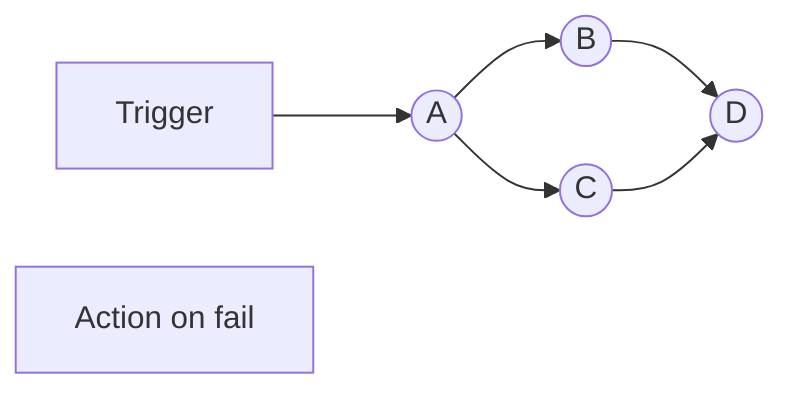
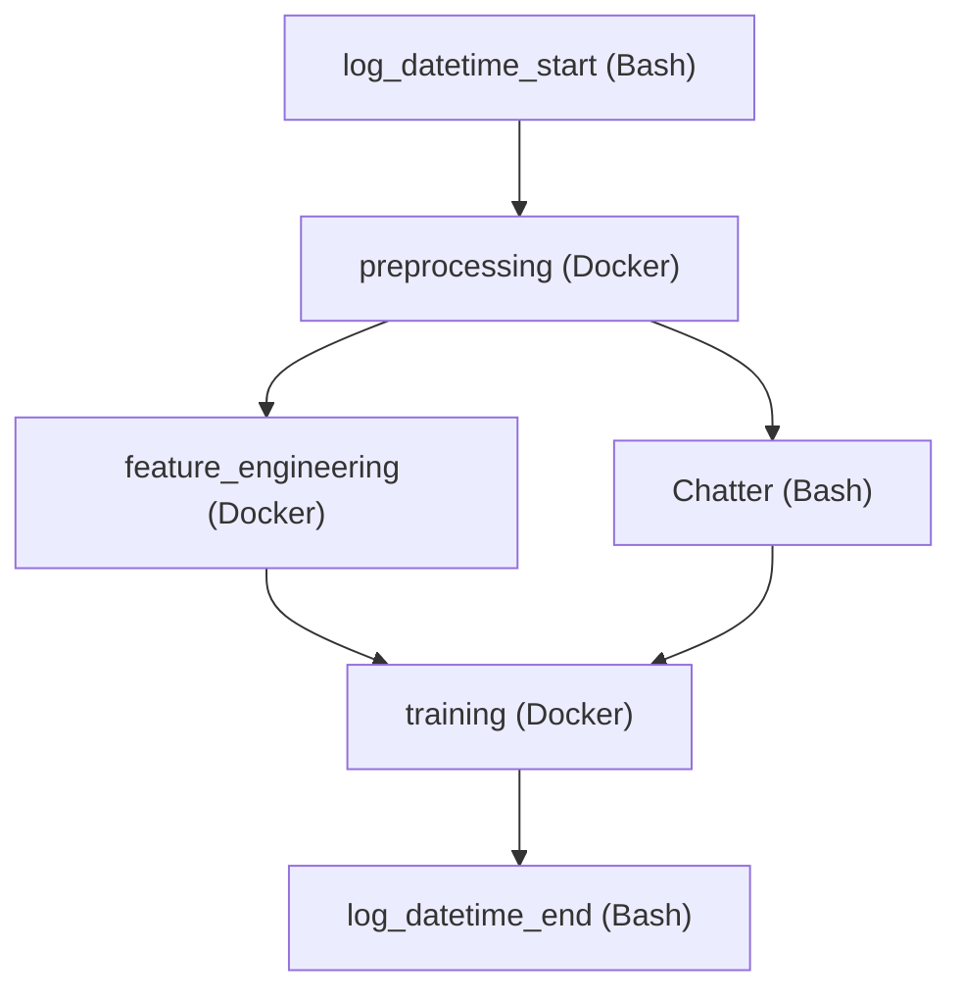

# EPRM-L04: Deployment Patterns

> [!abstract] In short
> A trained model earns nothing until something uses its predictions, so how do you get them to whoever needs them? There are four ways: **batch** (a workflow that starts on a trigger, runs and exits), **API** (a service that is always up and answers requests), **streaming** (a system that reacts to every message on a stream) and **edge** (the model runs on the user's device). The course works with the two most common. A batch workflow is a DAG of tasks, which the course runs with **Airflow**: each task is a container, arrows say what waits for what, and a schedule or event starts it. An API is a set of HTTP endpoints, such as `/predict` and `/health`, which the course builds with **Flask**. Between the two sits a quiet danger: serving has to turn inputs into features exactly as training did, with the statistics saved at training time, or predictions go wrong without any error.
>
> There is no written exam: this feeds Assignment 4 (scheduling the training DAG, reloading the API's model from the DAG, passing a new feature's state from training to the API) and the course project, which starts after this week.

## A model has to reach someone

[[EPRM-L01 - Data Roles, ML Lifecycle, Clean Code and Unit Testing|Week 1]] opened with the finding that most ML projects never deliver value, often because the model is never deployed: without production deployment there is no economic value. Week 3 showed how to package code in a [[Docker]] container so it runs the same everywhere. This week answers the next question: once the model is packaged, **in what shape does it serve predictions?**

The lecturer, Kemal Yesilbek, points out that the answer, like the rest of MLOps, comes from backend engineering. Ordinary software already had to decide whether work runs as a nightly job, as a web service, or on the user's phone. An ML model is one more piece of software making that choice.

## Four ways to serve a model

> [!definition] The four ways to serve or deploy an ML/AI system
> - **Batch:** predefined processes that start and stop. They run and exit.
> - **API:** a way to let other systems interact with yours. It is always up.
> - **Streaming:** uses a message bus. The system listens to one or more message streams and acts on them.
> - **Edge:** the model is deployed directly on a device.

A **message bus** is a shared channel (Kafka is a common one, from outside the course material) where producers publish events, such as "payment made", and any number of consumers read them as they arrive.

The difference that matters most is **who starts the work, and when**:

| | Batch | API | Streaming | Edge |
|---|---|---|---|---|
| Starts on | a trigger | a request | a message | the app |
| Lifetime | runs, exits | always up | always listening | on the device |
| Predictions are | precomputed | fresh per request | fresh per event | local, offline |
| Example | nightly scores for all users | `/predict` for a web shop | fraud check per payment | text recognition on a phone |

The consequences follow from the first row. Batch computes predictions **ahead of time** for everything that exists when it runs. That is cheap and simple, and nobody waits for the model, but a user who signs up at noon has no prediction until the next run. An API computes a prediction **when asked**, so it is always fresh, but it must stay up and answer fast. Streaming reacts to events without anyone asking. Edge removes the network: the device needs no connection and the data never leaves it, but the model has to fit the device, and updating it means updating every device.

The course looks only at **batch and APIs**, the most common two. The reading by Christian Kästner (see [[EPRM-Book Ch10 - Deploying a Model]]) cuts the space slightly differently: the model as a **library** inside an application (which covers edge), the model as a **service** (the API), **batch processing**, and **cached predictions**, where every prediction is computed ahead of time and serving is a lookup in a table. His point about choosing: the decision follows from the system's requirements (latency, offline use, privacy, cost, how often the model changes), and hybrids are common. See [[ML Deployment Patterns]].

## Batch: a workflow that starts and stops

A batch process (also called a workflow, pipeline or process) has three parts:

- it **starts and stops**: it runs to completion and exits;
- it is **composed of tasks**, each a unit of execution (one script, one container run);
- it begins when a **trigger** fires.

The trigger can be many things, or several at once:

- **a schedule:** every night at 02:30, every Monday;
- **a file arrival:** a new export lands in a storage bucket;
- **CDC (change data capture):** a change in a source database, such as new or updated rows, is detected (usually by reading the database's change log, from outside the course material) and starts the workflow.

Written out as a template, every batch workflow says:

> When *trigger* happens, start the workflow *name*, which starts task A; when A finishes, starts tasks B and C; when B and C finish, starts task D. If the workflow fails, do *action*.



The action on failure is part of the definition: alert someone, retry, or clean up partial output.

### The structure is a DAG

> [!definition] DAG
> The structure of the tasks is called a **DAG**, a **directed acyclic graph**: tasks are nodes, and an arrow from A to B means B starts only after A finishes. *Directed* because the arrows have a direction; *acyclic* because no path leads back to where it started.

The lecturer warns that the name is easy to confuse with the data structure, and Airflow's documentation now writes "Dag" for the workflow for that reason. Two properties of the graph do the work:

- **No cycles, so it can finish.** If D also had to finish before A, then A would wait on D, which waits on B, which waits on A: nothing could ever start.
- **Independent branches run in parallel.** B and C both depend only on A, so once A is done they can run at the same time. D waits for both.

Splitting a job into tasks is also the recovery design from [[EPRM-L02 - Distributed Data Processing|week 2]]: when each task saves its output and the next one reads it, a crash means rerunning one task instead of the whole multi-day job. The DAG is where that split becomes explicit.

## Airflow: the course's batch orchestrator

[[Apache Airflow]] is an open-source tool that runs DAGs: it reads DAG definitions written in Python, starts each task when its upstream tasks have succeeded, starts the whole DAG when its schedule or trigger fires, and shows every run and task in a web interface.

The course's training pipeline is one DAG, `nova_training`:



Two of the tasks are part of it:

```python
model_training_task = DockerOperator(
    docker_url="unix://var/run/docker.sock",
    command="python src/main_training.py --training",
    image="nova:latest",
    network_mode="infra_default",
    task_id="training",
    mounts=[Mount(source="data", target="/nova/data")],
    dag=dag,
)

log_datetime_end_task = BashOperator(
    task_id="log_datetime_end",
    bash_command="echo date",
    dag=dag,
)

(
    log_datetime_start_task
    >> preprocessing_task
    >> [feat_eng_task, completely_unnecessary_task_to_display_parallelism]
    >> model_training_task
    >> log_datetime_end_task
)
```

How to read it:

- **An operator is a kind of task.** `BashOperator` runs a shell command. `DockerOperator` starts a container from an image and runs a command in it. The three real stages (preprocessing, feature engineering, training) are the same image, `nova:latest`, run with a different flag to `main_training.py` each time. The Bash tasks only print the time. `Chatter`, which the code honestly names `completely_unnecessary_task_to_display_parallelism`, exists to show two tasks running side by side.
- **`>>` is "then".** `a >> b` means b runs after a. A list fans out (`preprocessing >> [feat_eng, chatter]`: both start when preprocessing is done) and fans in (`[feat_eng, chatter] >> training`: training waits for both).
- **The DockerOperator's settings** (explained from outside the course material, Docker and Airflow documentation). `docker_url` points at the Docker daemon's socket, so Airflow asks the host's Docker to start each task as a new container next to the others. `network_mode="infra_default"` attaches that container to the network Docker Compose created for the `infra/` project, so it can reach the MLflow server by its service name, as in week 3. `Mount(source="data", ...)` attaches a named Docker volume called `data` at `/nova/data`: every task container sees the same volume, which is how the feature engineering task reads what preprocessing wrote.

Each stage being a separate container run that hands files to the next is the week 2 recovery design in practice: if training crashes, the preprocessed data and features are still on the volume.

### Making a DAG run on its own

The DAG in the course code has no schedule, so it only runs when someone presses the trigger button. Scheduling it is the first part of Assignment 4. What follows is from outside the course material (Airflow documentation, for Airflow 3, the version the course uses):

```python
import pendulum
from airflow.sdk import DAG

with DAG(
    dag_id="my_pipeline",
    schedule="30 2 * * *",
    start_date=pendulum.datetime(2026, 11, 1, tz="Europe/Amsterdam"),
    catchup=False,
    default_args={"retries": 1},
) as dag:
    ...
```

- **`schedule`** takes a **cron expression**, five fields: `minute hour day-of-month month day-of-week`. `30 2 * * *` is minute 30, hour 2, every day of every month, any weekday: daily at 02:30. `0 * * * *` is hourly, `0 9 * * 1` is Mondays at 09:00. Presets such as `"@daily"` (midnight) also work, and `None` means manual runs only.
- **`start_date`** is the earliest moment a scheduled run may happen. Airflow needs it to know where the schedule begins.
- **Time zone.** Airflow works in UTC by default, so a cron time without a time zone means UTC. A `start_date` built with `pendulum` and `tz="Europe/Amsterdam"` makes the cron times Amsterdam times, daylight saving included.
- **`catchup`.** If `start_date` lies in the past, Airflow could create a run for every missed slot since then. In Airflow 3 the default is not to (`catchup=False`): it runs only the most recent slot and continues from there.
- **New DAGs start paused.** Airflow's default configuration creates every new DAG in the paused state, and a paused DAG is never scheduled until someone switches it on in the interface (or the DAG is created with `is_paused_upon_creation=False`).
- **The action on fail.** `retries` reruns a failed task; `on_failure_callback` on the DAG runs a function when a run fails, such as sending an alert.
- **Removing a task** means deleting its operator and its place in the `>>` chain. Leaving the operator defined but unconnected still adds it to the DAG as a task with no dependencies.

## APIs: a service that is always up

> [!definition] API, as the course puts it
> A **service** that is always up and ready to receive requests. Upon a request, with or without input, it runs a specific process (an **endpoint**) and returns a result, with or without data. **HTTP APIs** are the most common.

Batch pushes predictions out on its own schedule. An API waits for others to pull a prediction when they need one, which makes it the pattern for anything interactive. See [[HTTP API]].

### What goes over the wire

Every HTTP API call is a request from a **client** (a browser, `curl`, another service) to a **server**, and a response back:

| The client sends | The server returns |
|---|---|
| **HTTP method:** GET, POST, PUT, DELETE | **Status code:** 200, 500, ... |
| **URL / endpoint:** `/predict`, `/score`, `/health`, `/order` | **Response data:** JSON, HTML |
| **Params** (optional): `?<param>=<val>` in the URL | |
| **Body / payload** (optional): the data | |

Three examples make it concrete:

- **Fetching data with GET.** Opening `dog.ceo/api/breeds/list/all` in a browser sends a GET to the endpoint `/api/breeds/list/all` with no parameters and no body. The response is JSON: a `message` object mapping each breed to its sub-breeds (`"australian": ["kelpie", "shepherd"]`, `"beagle": []`).
- **Parameters in the URL.** `google.com/search?q=hello+world&hl=en` is a GET to `/search` with two parameters: `q` (the query, with `+` standing for a space) and `hl` (interface language). The response is an HTML page.
- **A body with POST.** The colour palette service Colormind has two endpoints. `curl 'http://colormind.io/list/'` (a GET) returns the available models as JSON. Then `curl 'http://colormind.io/api/' --data-binary '{"input":[[44,43,44],[90,83,82],"N","N","N"],"model":"default"}'` sends a POST (curl switches to POST when given data) whose body fixes two colours and marks three free slots with `"N"`. The response is a full five-colour palette that keeps the given two (nearly unchanged) and fills the rest: a model prediction behind an API.

**The methods** (from outside the course material): GET fetches something and carries its inputs in the URL; POST sends a body for the server to process; PUT creates or replaces the thing at a URL; DELETE removes it. A prediction request with a feature vector is usually a POST with a JSON body.

**Status codes** group by their first digit: 2xx means success (200 OK), 4xx means the client got something wrong (400 bad request, 404 not found, 405 method not allowed), 5xx means the server failed (500 internal server error, 503 service unavailable). The course names 200 and 500, the two you see most.

A **`/health` endpoint** answers "are you up?" with a cheap 200. It is what a Docker Compose health check from [[EPRM-L03 - Containerization and Software Engineering Processes|week 3]] can call before dependent services start, and what an orchestrator polls to restart a dead service.

### A model behind an API with Flask

The course's API is written in Flask, a small Python web framework; its quickstart is a reading for the week. The sketch below is from that reading and from Kästner's chapter, and the course code follows the same shape, with `/health` and a POST `/predict`.

```python
import pickle
from flask import Flask, request

app = Flask(__name__)

with open("models/model.pkl", "rb") as f:
    model = pickle.load(f)          # loaded once, when the process starts

@app.route("/health")               # GET only, by default
def health():
    return {"status": "ok"}          # a dict is returned as JSON, status 200

@app.route("/predict", methods=["POST"])
def predict():
    payload = request.get_json(silent=True)   # the JSON body, None if invalid
    if payload is None or "features" not in payload:
        return {"error": "send JSON with 'features'"}, 400
    y = model.predict([payload["features"]])
    return {"prediction": y.tolist()}
```

```bash
flask --app app run --host 0.0.0.0 --port 5001
curl http://localhost:5001/health
curl -X POST http://localhost:5001/predict \
     -H "Content-Type: application/json" -d '{"features": [120.5, 3, 0]}'
```

What to notice:

- **`@app.route` binds a URL to a function.** By default a route answers only GET; `methods=["POST"]` (or the shortcut `@app.post`) changes that, and a request with another method gets **405**.
- **Return values become responses.** A string becomes an HTML response, a dict or list becomes JSON, and a tuple `(body, status)` sets the status code. An unhandled exception in the function becomes a **500**.
- **`request.get_json()`** reads a JSON body, `request.args` the URL parameters. The client has to send the header `Content-Type: application/json`; without it, or with broken JSON, plain `get_json()` aborts the request with a 4xx error, while `silent=True` returns `None` so the view can send its own 400.
- **`--host 0.0.0.0`.** By default the development server listens only on `127.0.0.1`, which inside a container is the container itself (the week 3 pitfall).
- **The model is loaded once, at start-up**, and every request reuses it. Loading a pickle per request would make every prediction slow.
- **Development server only.** `flask run` is meant for development; the Flask docs warn against using it, and especially its debug mode, in production, where a WSGI server such as gunicorn runs the app (Kästner's Dockerfile does this).
- **Testing** (from outside the course material, Flask testing docs): `app.test_client()` sends fake requests without a running server, so endpoints can be unit-tested like functions: `client.post("/predict", json={...})` returns a response whose `status_code` and `get_json()` you assert on.

## Same features in training and serving

The model was trained on **features**, and an API receives **raw inputs**: a transaction with an amount and a category, never a z-scored amount and a one-hot vector. So the API must run the same feature encoding as training. Kästner calls the failure **[[Training-Serving Skew|training-serving skew]]**: when the encoding at inference differs from the one at training, runtime data no longer matches the training data, and predictions are wrong while nothing crashes. The mismatch can be one feature scaled differently or completely scrambled inputs.

Some encodings depend on numbers learned from the training data. A z-score needs the training mean and standard deviation; an index or one-hot encoding needs the list of categories seen in training; a "how common is this category" feature needs the training counts. Call these numbers the **feature state**. Serving has to use exactly that state:

- **Never recompute it from the request.** One request has one row: its mean is itself and its standard deviation is undefined. Even a batch of requests has different statistics from the training set, so the same raw value would map to a different feature.
- **Save it with the model.** Log the state as artifacts of the same [[MLflow]] run as the model, so a model and its state always travel together and cannot be mixed up across versions.
- **Write the encoding once.** One function, imported by both the training code and the API (Kästner's advice), so the two cannot drift apart.

From outside the course material (MLflow documentation), a minimal version of all three:

```python
# src/features.py: imported by training AND by the API
def fit_state(train_df):                        # training only
    return {"amount_mean": float(train_df["amount"].mean()),
            "amount_std": float(train_df["amount"].std())}

def encode(df, state):                          # training and serving
    out = df.copy()
    out["amount_z"] = (out["amount"] - state["amount_mean"]) / state["amount_std"]
    return out

# training
with mlflow.start_run() as run:
    state = fit_state(train_df)
    mlflow.log_dict(state, "feature_state.json")
    model.fit(encode(train_df, state)[FEATURES], train_df["fraud"])
    ...                                         # log the model in the same run

# API start-up
state = mlflow.artifacts.load_dict(f"runs:/{run_id}/feature_state.json")
```

In large organisations a [[Feature Store]] takes this further: a central catalogue of feature code that can also precompute and cache feature values for many models.

## Getting a new model into a running API

The Flask app loads its model once, when it starts. That is what makes it fast, and it has a consequence: **retraining does not change what the API serves.** A nightly DAG can log a better model to MLflow every night while the API keeps answering with the model it loaded weeks ago, until the process restarts.

Two ways out (the second is part two of Assignment 4):

- **Restart or redeploy the service** after training. Simple, but the API is briefly down unless several instances are restarted one at a time.
- **Hot reload:** the API gets an endpoint that makes it load the latest model, with its feature state, while it keeps running. The training DAG then ends with one more task that calls that endpoint once training has succeeded. Scheduling, training, logging and serving become one automatic loop: the schedule starts the DAG, training logs a new run to MLflow, and the last task tells the API to pick it up.

Design points for a reload (from outside the course material):

- **Load fully, then swap.** Build the new model and state in memory first, and replace the old ones only when loading succeeded. If loading fails, the old model keeps serving and the reload returns an error status.
- **Swap model and state together**, both from the same MLflow run, or the API briefly encodes with one run's statistics and predicts with another run's model: training-serving skew by timing.
- **Cached loaders keep the old model.** If the model sits in a module-level variable or behind a memoising cache such as `functools.cache`, it stays there until that variable is replaced or the cache is cleared.
- **Reload changes state, so it is a POST**, and in a real system it is not open to the public.

Finding "the latest model" in MLflow, from outside the course material (MLflow documentation):

```python
import pickle
import mlflow

runs = mlflow.search_runs(
    experiment_names=["Alpha"],
    filter_string="attributes.status = 'FINISHED'",   # skip runs still training
    order_by=["attributes.start_time DESC"],
    max_results=1,
)
run_id = runs.iloc[0]["run_id"]
path = mlflow.artifacts.download_artifacts(run_id=run_id, artifact_path="alpha.pkl")
with open(path, "rb") as f:
    model = pickle.load(f)
```

## What to be able to do

- Name the four ways to serve a model, say who starts the work in each, and pick one for a scenario.
- Describe a batch workflow: triggers (schedule, file arrival, CDC), tasks, the DAG, the action on failure, and why the graph must be acyclic.
- Read an Airflow DAG: operators, `>>` with lists, which tasks run in parallel, and how DockerOperator tasks share data and reach other services.
- Give a DAG a schedule with a cron expression, and know what `start_date`, the time zone, `catchup` and paused DAGs do.
- Take an HTTP request and response apart: method, endpoint, parameters, body, status code, response data.
- Build a Flask API with `/health` and a POST `/predict`, load the model once, return the right status codes, and test it.
- Explain training-serving skew, and pass feature state from training to serving through MLflow.
- Explain why a retrained model does not reach a running API, and how a reload triggered by the training DAG fixes it.

## Exam questions

> [!exam]- Name the four ways to serve an ML model and choose one for each: nightly churn scores for all customers; a web shop that recommends products as a page loads; a fraud check on every payment event on a message bus; text recognition in an app that must work offline.
> **Key points:** batch runs on a trigger and exits; API is always up and answers requests; streaming listens to a message bus and acts per message; edge runs on the device; churn: batch, shop: API, payments: streaming, offline app: edge.
>
> Batch is a predefined workflow that starts on a trigger, runs and exits; API is a service that is always up and answers requests from other systems; streaming listens to one or more message streams and acts on each message; edge deploys the model on the device itself. Nightly churn scores for everyone suit batch: predictions can be computed ahead of time and nobody waits for them. A recommendation while a page loads needs a fresh prediction on demand, so an API. A fraud check per payment event arriving on a bus is streaming: the system reacts to each message without anyone requesting it. Text recognition that must work offline has to run on the device: edge, which also keeps the user's images local, at the cost of the device's limited hardware and harder model updates.

> [!exam]- What is a batch workflow, what can trigger it, and why is its task structure a directed acyclic graph?
> **Key points:** a workflow that starts on a trigger, runs and exits; made of tasks, the units of execution; triggers: schedule, file arrival, change data capture; arrows say which task waits for which; acyclic so it can finish, independent branches run in parallel; defines an action on fail.
>
> A batch workflow (pipeline, process) starts when its trigger fires, runs to completion and exits. It is made of tasks, each a unit of execution such as a script or a container run. Triggers include a schedule, a file arriving and change data capture, where a change in a source database starts the run. The tasks and their dependencies form a DAG: nodes are tasks, and an arrow from A to B means B starts only after A finishes. The graph must be acyclic, because a cycle would make a task wait on itself through the others and nothing in the cycle could ever start. Tasks that do not depend on each other can run in parallel. The workflow also defines what to do when it fails, such as retrying or alerting, and splitting it into tasks that save their outputs means a crash only reruns the failed task.

> [!exam]- In an Airflow DAG written as `start >> prep >> [feats, chatter] >> train >> end`, which tasks can run at the same time, and how do DockerOperator tasks pass data to each other?
> **Key points:** >> means runs after; a list fans out and fans in; feats and chatter run in parallel after prep; train waits for both; each DockerOperator task is a new container; data passes through a shared mounted volume; network_mode puts it on the Compose network to reach services by name.
>
> In Airflow `a >> b` means b runs after a. After `prep` finishes, both tasks in the list `[feats, chatter]` can start, so they run in parallel; `train` waits until both have succeeded, since by default a task needs all its upstream tasks to succeed, and `end` runs last. A DockerOperator task starts a fresh container from an image (for example the same image with a different command-line flag per stage), so nothing in memory carries over between tasks. Data passes through storage they share: a Docker volume mounted into every task container, where each stage writes its output and the next reads it. Setting the network mode to the Docker Compose network lets the task containers reach services such as the MLflow server by their service names. Saving each stage's output also means a failed stage can be rerun without redoing the earlier ones.

> [!exam]- Your training DAG only runs when you press the trigger button. How do you make it run every night at 01:15 Amsterdam time, and what could still stop it from running?
> **Key points:** set schedule to the cron expression 15 1 * * *; give a start_date; make it Amsterdam time with a pendulum start_date with that time zone, since Airflow defaults to UTC; catchup decides whether missed slots are replayed, off by default in Airflow 3; new DAGs start paused and must be switched on.
>
> Give the DAG a schedule and a start date. The schedule is a cron expression with five fields, minute, hour, day of month, month and day of week, so `15 1 * * *` means 01:15 every day. Airflow interprets cron times in UTC unless the DAG has a time zone, so the start date should be time-zone aware, for example `pendulum.datetime(2026, 11, 1, tz="Europe/Amsterdam")`; that also handles daylight saving. The start date is the earliest point a scheduled run may happen. If it lies in the past, `catchup` decides whether every missed night is replayed; in Airflow 3 it is off by default, so only the latest slot runs. Even then the DAG will not run while it is paused, and Airflow creates new DAGs paused by default, so it has to be switched on in the interface. A failure inside a task is handled with retries and a failure callback.

> [!exam]- Describe what a client sends and what a server returns in an HTTP API call, with an example of a GET and a POST.
> **Key points:** client sends method, endpoint, optional URL parameters, optional body; server returns status code and response data such as JSON or HTML; GET carries inputs in the URL; POST carries a body; 2xx success, 4xx client error, 5xx server error.
>
> The client sends an HTTP method (GET, POST, PUT, DELETE), the URL of an endpoint such as `/predict` or `/health`, optional parameters in the URL as `?param=value`, and an optional body or payload with data. The server runs the process behind that endpoint and returns a status code and response data, typically JSON or HTML. A GET such as `google.com/search?q=hello+world&hl=en` passes its inputs as URL parameters and returns an HTML page; `dog.ceo/api/breeds/list/all` is a GET without parameters that returns JSON. A POST sends a body: posting `{"input": [...], "model": "default"}` to Colormind's `/api/` returns a generated colour palette as JSON. Status codes in the 2xx range mean success (200), 4xx mean the client made an error (404 not found, 405 wrong method), 5xx mean the server failed (500).

> [!exam]- Sketch a Flask API that serves a fraud model. Which endpoints and methods do you use, where is the model loaded, and which status codes can a client get?
> **Key points:** a GET /health returning 200; a POST /predict reading a JSON body; load the model once at start-up and reuse it; return JSON from a dict; 400 for a bad body, 405 for a wrong method, 500 for a server crash; listen on 0.0.0.0 in a container; production behind a WSGI server.
>
> Create a Flask app, load the pickled model once when the process starts, and define two routes. `/health` answers GET with a small JSON body and status 200, so health checks and orchestrators can see the service is up. `/predict` accepts POST, reads the transaction from the JSON body with `request.get_json()`, encodes it into features with the training-time feature state, calls the model and returns the prediction as a dict, which Flask turns into JSON with status 200. If the body is missing or malformed the function returns an error with 400; a GET to `/predict` gets 405 because the route only allows POST; an unhandled exception inside the model code becomes a 500. Loading the model per request would make every call slow, so it stays in memory. In a container the server must listen on 0.0.0.0, and in production it runs under a WSGI server such as gunicorn, since Flask's development server is not meant for production.

> [!exam]- What is training-serving skew, and how do you pass a feature such as a z-scored amount correctly from training to an API?
> **Key points:** encoding at serving differs from encoding at training, so predictions go wrong silently; the z-score needs the training mean and standard deviation; never compute statistics from the request; save the state as artifacts in the same MLflow run as the model and load them together; one shared encoding function for training and serving.
>
> Training-serving skew is a mismatch between how inputs become features during training and during inference. The model then sees runtime data that does not match its training data and returns wrong predictions without any error. A z-scored amount depends on the mean and standard deviation of the training data. The API must use those exact numbers: computing them from the request is wrong, since one row has no standard deviation and any batch of requests has different statistics. So training computes the state, logs it as an artifact (for example a JSON file) in the same MLflow run as the model, and the API loads model and state from the same run. The encoding itself is written once, as a function imported by both the training code and the API, so the two cannot drift apart. At larger scale a feature store plays this role.

> [!exam]- A DAG retrains your model every night and logs it to MLflow, yet the API keeps returning the same predictions as last month. Why, and how do you fix it?
> **Key points:** the API loads the model once at start-up and keeps it in memory; new MLflow runs are never read; fix by restarting the service or by a reload endpoint; the DAG's last task calls the reload after training succeeds; load fully before swapping, swap model and feature state together, keep the old model if loading fails.
>
> The API loads its model, and its feature state, once when the process starts and reuses it for every request, so models logged to MLflow afterwards are never read; if the loading function is cached, the cache keeps returning the old one. One fix is to restart or redeploy the service after every training run. The other is a hot reload: an endpoint, called with POST, that makes the running API look up the latest finished run in the MLflow experiment, load its model and feature state, and replace the ones in memory. The training DAG then gets a final task, after training, that calls this endpoint, so each night's model goes live automatically. The new model and state should be loaded completely before swapping, both from the same run, and if loading fails the old model keeps serving and the reload reports an error.

## Flashcards

> [!card]- What are the four ways to serve or deploy an ML/AI system?
> Batch, API, streaming, edge.

> [!card]- Which two deployment patterns does the EPRM course focus on, and why?
> Batch and API: they are the most common.

> [!card]- Where do ML deployment patterns come from, according to Yesilbek?
> Backend engineering, like other MLOps principles.

> [!card]- What characterises batch deployment?
> Predefined processes that start on a trigger, run and exit.

> [!card]- What characterises an API?
> A service that is always up and ready to receive requests.

> [!card]- What does a streaming system do?
> Listens to one or more message streams on a bus and acts on each message.

> [!card]- What is edge deployment?
> Deploying the model directly on the device that uses it.

> [!card]- A user signs up after the nightly batch scoring ran. When do they get a prediction?
> Only at the next batch run.

> [!card]- Why might you choose edge deployment over an API?
> It works offline, keeps data on the device and has no network latency.

> [!card]- What is the downside of edge deployment for model updates?
> Every device has to download and install the new model.

> [!card]- What is a task in a batch workflow?
> The unit of execution, such as one script or container run.

> [!card]- Name three kinds of trigger for a batch workflow.
> A schedule, a file arrival, change data capture.

> [!card]- What is change data capture (CDC)?
> Detecting changes in a source database and using them to start processing.

> [!card]- Besides tasks and a trigger, what else does a batch workflow define?
> An action to take when the workflow fails.

> [!card]- What does DAG stand for?
> Directed acyclic graph.

> [!card]- Why must a workflow's task graph be acyclic?
> A cycle would make a task wait on itself, so it could never start.

> [!card]- In a DAG where A comes before B and C, and both come before D, which tasks can run in parallel?
> B and C, since both depend only on A.

> [!card]- What does Apache Airflow do?
> Runs DAGs of tasks on schedules or triggers and records every run.

> [!card]- In Airflow, what does a >> b mean?
> Task b runs after task a finishes.

> [!card]- In Airflow, what does a >> [b, c] mean?
> b and c both start after a, and can run in parallel.

> [!card]- What is the difference between a BashOperator and a DockerOperator?
> BashOperator runs a shell command; DockerOperator starts a container and runs a command in it.

> [!card]- How do DockerOperator tasks in one Airflow DAG pass data to each other?
> Through a shared mounted volume where each task writes and the next reads.

> [!card]- Why set network_mode to the Compose network on a DockerOperator?
> So the task container can reach services like MLflow by service name.

> [!card]- What does the Airflow schedule "30 2 * * *" mean?
> Every day at 02:30.

> [!card]- What are the five fields of a cron expression, in order?
> Minute, hour, day of month, month, day of week.

> [!card]- In which time zone does Airflow read a cron schedule by default?
> UTC, unless the start_date carries another time zone.

> [!card]- What does catchup control in Airflow?
> Whether runs are created for every missed slot since start_date.

> [!card]- Why might a newly added Airflow DAG with a schedule never run?
> New DAGs start paused until someone switches them on.

> [!card]- What four things can a client send in an HTTP request?
> Method, URL or endpoint, optional parameters, optional body.

> [!card]- What two things does an HTTP API return?
> A status code and response data, such as JSON or HTML.

> [!card]- Where does a GET request carry its inputs?
> In the URL, as query parameters like ?q=hello.

> [!card]- Which HTTP method fits sending a JSON feature vector for a prediction?
> POST, with the features in the body.

> [!card]- What do 4xx and 5xx status codes each mean?
> 4xx: the client made an error. 5xx: the server failed.

> [!card]- What status code does Flask return for a GET to a POST-only route?
> 405, method not allowed.

> [!card]- What is a /health endpoint for?
> Letting health checks and orchestrators see whether the service is up.

> [!card]- What does a Flask view that returns a dict send to the client?
> A JSON response with status 200.

> [!card]- Why load the model at API start-up instead of per request?
> Loading per request would make every prediction slow.

> [!card]- Why must a Flask app in a container listen on 0.0.0.0?
> 127.0.0.1 inside a container is only the container itself.

> [!card]- Why not run Flask's built-in server in production?
> It is a development server; production uses a WSGI server like gunicorn.

> [!card]- How do you test Flask endpoints without starting a server?
> With app.test_client(), sending fake requests and checking status and JSON.

> [!card]- What is training-serving skew?
> Feature encoding at inference differing from training, giving silently wrong predictions.

> [!card]- Why must an API not compute z-score statistics from incoming requests?
> They differ from training statistics; a single row has no standard deviation.

> [!card]- Where should training-time feature state be stored for an API to use?
> As artifacts in the same MLflow run as the model.

> [!card]- How do you keep training and serving feature code from drifting apart?
> Write the encoding once and import it from both.

> [!card]- What is a feature store?
> A central catalogue of reusable feature code that can precompute and cache features.

> [!card]- Why does a nightly retrained model not reach a running API by itself?
> The API loaded its model once at start-up and keeps using it.

> [!card]- What is a hot reload of a model?
> Making the running API load the latest model without restarting it.

> [!card]- How can a training DAG make the API serve the new model?
> Add a final task that calls the API's reload endpoint.

> [!card]- Why load a new model fully before swapping it in?
> If loading fails, the old model keeps serving.

> [!card]- Why reload the model and its feature state together?
> Mixing runs gives training-serving skew.

## Links

- **Course:** [[EPRM - Overview|Course overview]]
- **Previous lecture:** [[EPRM-L03 - Containerization and Software Engineering Processes]] (containers, Compose service names and health checks, MLflow)
- **Earlier material this builds on:** [[EPRM-L01 - Data Roles, ML Lifecycle, Clean Code and Unit Testing]] (no deployment, no value; the MLOps loop) · [[EPRM-L02 - Distributed Data Processing]] (splitting a job into recoverable tasks)
- **Reading note:** [[EPRM-Book Ch10 - Deploying a Model]]
- **Concepts:** [[ML Deployment Patterns]] · [[Apache Airflow]] · [[HTTP API]] · [[Training-Serving Skew]] · [[Feature Store]] · [[MLflow]] · [[Docker]] · [[MLOps]]
- **Source:** lecture slides and speaker notes, "Week 4: Deployment Patterns", Kemal T. Yesilbek, 18 November 2026. The `nova_training` DAG and its code are from the lecture; the dog.ceo, Google and Colormind requests are its API examples. The two live coding parts used `kemalty/uva-mlprod-code` (`deploying-ml-systems/1-orchestration`), which was not available for this note; the description of the course API's routes comes from the week 4 branch of the course code.
- **Readings for the week:** Christian Kästner, *Machine Learning in Production*, Chapter 10 "Deploying a Model", https://mlip-cmu.github.io/book/10-deploying-a-model.html (see the reading note). Chip Huyen, *Designing Machine Learning Systems* (O'Reilly, 2022), listed as "Chapter 6: Deployment"; the book's deployment chapter is Chapter 7, "Model Deployment and Prediction Service". Not freely available, so no note. Flask, Quickstart, https://flask.palletsprojects.com/en/stable/quickstart/.
- **Further (used for the additions marked as outside the course material):** Airflow documentation on Dags, Dag runs and catchup, and time zones, https://airflow.apache.org/docs/apache-airflow/stable/core-concepts/dags.html, https://airflow.apache.org/docs/apache-airflow/stable/core-concepts/dag-run.html, https://airflow.apache.org/docs/apache-airflow/stable/authoring-and-scheduling/timezone.html; Flask testing documentation, https://flask.palletsprojects.com/en/stable/testing/; MLflow tracking and artifacts API, https://mlflow.org/docs/latest/ml/tracking/.
